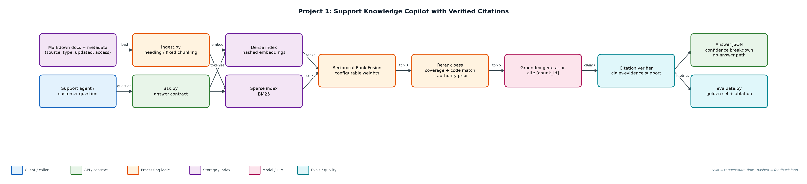

# Project 1: Support Knowledge Copilot with Verified Citations

`RAG` `Hybrid retrieval` `Citation verification` `Retrieval evals`

Answers support questions from internal docs, cites every claim, and proves each citation actually supports the claim.

## Goals
| Goal | Success criterion |
|---|---|
| Hybrid retrieval over shared chunk ids | Dense + BM25 fused with RRF; rerank top pool |
| Grounded answers with chunk-level citations | 100% of answer sentences carry a [chunk_id] |
| Automatic citation verification | Unsupported citations flagged in could_not_verify |
| Calibrated no-answer behaviour | Refusal accuracy on unanswerable questions >= 95% |
| Reproducible evaluation | 38-question golden set, strategy ablation report in reports/ |

## Architecture

```mermaid
flowchart LR
    docs["Markdown docs + metadata<br/>(source, type, updated, access)"]:::store
    user["Support agent /<br/>customer question"]:::client
    ingest["ingest.py<br/>heading / fixed chunking"]:::logic
    api["ask.py<br/>answer contract"]:::api
    dense["Dense index<br/>hashed embeddings"]:::store
    bm25["Sparse index<br/>BM25"]:::store
    rrf["Reciprocal Rank Fusion<br/>configurable weights"]:::logic
    rerank["Rerank pass<br/>coverage + code match<br/>+ authority prior"]:::logic
    generate["Grounded generation<br/>cite [chunk_id]"]:::llm
    verify["Citation verifier<br/>claim-evidence support"]:::eval
    response["Answer JSON<br/>confidence breakdown<br/>no-answer path"]:::api
    evals["evaluate.py<br/>golden set + ablation"]:::eval
    docs -->|load| ingest
    ingest -->|embed| dense
    ingest -->|tokenise| bm25
    user -->|question| api
    api --> dense
    api --> bm25
    dense -->|ranks| rrf
    bm25 -->|ranks| rrf
    rrf -->|top 8| rerank
    rerank -->|top 5| generate
    generate -->|claims| verify
    verify --> response
    verify -->|metrics| evals
    classDef client fill:#E3F2FD,stroke:#1565C0,color:#1A1A1A
    classDef api fill:#E8F5E9,stroke:#2E7D32,color:#1A1A1A
    classDef logic fill:#FFF3E0,stroke:#E65100,color:#1A1A1A
    classDef store fill:#F3E5F5,stroke:#6A1B9A,color:#1A1A1A
    classDef llm fill:#FCE4EC,stroke:#AD1457,color:#1A1A1A
    classDef eval fill:#E0F7FA,stroke:#00838F,color:#1A1A1A
    classDef ui fill:#FFFDE7,stroke:#F9A825,color:#1A1A1A
    classDef external fill:#ECEFF1,stroke:#455A64,color:#1A1A1A
```


<details><summary>Mermaid source</summary>


</details>

## Quick start
No third-party packages needed (Python 3.10+).

```bash
python ingest.py --rebuild
python ask.py "What does ERR-4012 mean?"
python ask.py "How long do customers have to request a refund?" --inject-bad-citation
python evaluate.py --strategy all
python -m unittest discover -s tests
```

## Sample output
```text
dense: top1=93.9% recall@5=100.0% refusal_acc=100.0% false_refusal=3.0% citation_valid=100.0%
       sparse: top1=97.0% recall@5=100.0% refusal_acc=100.0% false_refusal=0.0% citation_valid=100.0%
       hybrid: top1=93.9% recall@5=100.0% refusal_acc=100.0% false_refusal=3.0% citation_valid=100.0%
hybrid+rerank: top1=97.0% recall@5=100.0% refusal_acc=100.0% false_refusal=0.0% citation_valid=100.0%
Report: reports/eval_report.md
```

## Files
| Path | Purpose |
|---|---|
| data/docs/ | Support corpus with front-matter metadata |
| data/golden.jsonl | Golden evaluation questions |
| ingest.py | Chunking and index build |
| retrieval.py | BM25, dense search, RRF, rerank |
| answer.py | Generation, citation verification, confidence |
| evaluate.py | Eval runner and report |
| ask.py | CLI |
| tests/ | Unit tests |

## Documentation
- [docs/PROJECT_EXPLANATION.md](docs/PROJECT_EXPLANATION.md) · [docs/PROJECT_EXPLANATION.docx](docs/PROJECT_EXPLANATION.docx): full explanation
- [docs/PRESENTATION.pptx](docs/PRESENTATION.pptx): slide deck for walkthroughs and interviews
