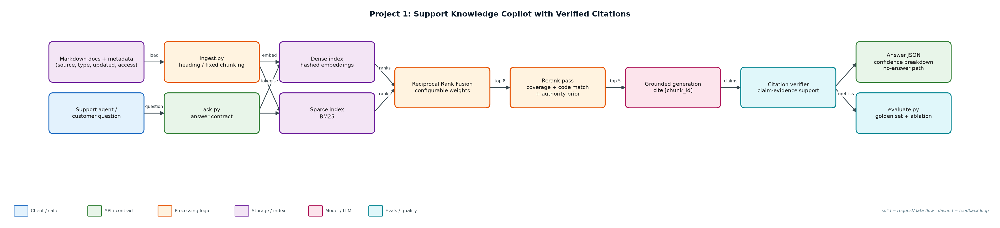

# Project 1: Support Knowledge Copilot with Verified Citations

**Primary topic:** RAG · **Secondary:** Hybrid retrieval, Citation verification, Retrieval evals

> Answers support questions from internal docs, cites every claim, and proves each citation actually supports the claim.

## 1. Problem
Basic RAG demos answer confidently even when retrieval missed the right document, cite chunks that do not support the sentence, and never admit that the answer is not in the docs. Support teams cannot ship that: a wrong refund or security answer is worse than no answer.

### Why it matters
- Exact identifiers (ERR-4012, HMAC, 429) break pure semantic search; paraphrases break pure keyword search.
- Citations are only useful if they are verified; unverified citations create false trust.
- Honest 'I could not find this' answers protect customers and reduce escalations.
- Separate retrieval metrics from answer metrics so you know which layer to fix.

## 2. Goals and success criteria
| Goal | Success criterion |
|---|---|
| Hybrid retrieval over shared chunk ids | Dense + BM25 fused with RRF; rerank top pool |
| Grounded answers with chunk-level citations | 100% of answer sentences carry a [chunk_id] |
| Automatic citation verification | Unsupported citations flagged in could_not_verify |
| Calibrated no-answer behaviour | Refusal accuracy on unanswerable questions >= 95% |
| Reproducible evaluation | 38-question golden set, strategy ablation report in reports/ |

### Non-goals
- Building a chat UI (CLI + JSON contract is the deliverable; Streamlit is an optional extension).
- Training embedding models; embeddings are pluggable behind common/embeddings.py.

## 3. Architecture

```mermaid
flowchart LR
    docs["Markdown docs + metadata<br/>(source, type, updated, access)"]:::store
    user["Support agent /<br/>customer question"]:::client
    ingest["ingest.py<br/>heading / fixed chunking"]:::logic
    api["ask.py<br/>answer contract"]:::api
    dense["Dense index<br/>hashed embeddings"]:::store
    bm25["Sparse index<br/>BM25"]:::store
    rrf["Reciprocal Rank Fusion<br/>configurable weights"]:::logic
    rerank["Rerank pass<br/>coverage + code match<br/>+ authority prior"]:::logic
    generate["Grounded generation<br/>cite [chunk_id]"]:::llm
    verify["Citation verifier<br/>claim-evidence support"]:::eval
    response["Answer JSON<br/>confidence breakdown<br/>no-answer path"]:::api
    evals["evaluate.py<br/>golden set + ablation"]:::eval
    docs -->|load| ingest
    ingest -->|embed| dense
    ingest -->|tokenise| bm25
    user -->|question| api
    api --> dense
    api --> bm25
    dense -->|ranks| rrf
    bm25 -->|ranks| rrf
    rrf -->|top 8| rerank
    rerank -->|top 5| generate
    generate -->|claims| verify
    verify --> response
    verify -->|metrics| evals
    classDef client fill:#E3F2FD,stroke:#1565C0,color:#1A1A1A
    classDef api fill:#E8F5E9,stroke:#2E7D32,color:#1A1A1A
    classDef logic fill:#FFF3E0,stroke:#E65100,color:#1A1A1A
    classDef store fill:#F3E5F5,stroke:#6A1B9A,color:#1A1A1A
    classDef llm fill:#FCE4EC,stroke:#AD1457,color:#1A1A1A
    classDef eval fill:#E0F7FA,stroke:#00838F,color:#1A1A1A
    classDef ui fill:#FFFDE7,stroke:#F9A825,color:#1A1A1A
    classDef external fill:#ECEFF1,stroke:#455A64,color:#1A1A1A
```




### Components
| Component | File | Responsibility |
|---|---|---|
| Ingestion & chunking | ingest.py | Parses front-matter metadata, chunks by heading or fixed window, builds both indexes over the same chunk ids. |
| Hybrid retriever | retrieval.py | Dense cosine search, BM25, RRF fusion, rerank with query coverage, error-code bonus and authority prior. |
| Answer engine | answer.py | Extractive grounded generation, claim-level citation verification, confidence scoring, no-answer handling. |
| Evaluation | evaluate.py | Runs the golden set over 4 retrieval configurations and writes reports/eval_report.md. |
| CLI | ask.py | Prints the full answer contract as JSON; --inject-bad-citation demonstrates verification. |

## 4. Request / data flow
1. Ingest: Markdown files are parsed, metadata is stored on every chunk, and dense + BM25 indexes are built over identical chunk ids.
2. Retrieve: the question is searched densely and lexically; RRF merges both ranked lists into a candidate pool of 8.
3. Rerank: candidates are rescored by query-term coverage, dense similarity, exact error-code match, and a document-authority prior.
4. Gate: if the best chunk covers < 50% of the question terms, return a no-answer with the closest sections.
5. Generate: evidence sentences are selected and each claim is tagged with its [chunk_id].
6. Verify: every claim is compared with its cited chunk; claims below 60% support land in could_not_verify.
7. Score: confidence = 0.35 retrieval + 0.45 citation support + 0.2 completeness, returned with its breakdown.

## 5. Key design decisions
| Decision | Why | Trade-off |
|---|---|---|
| Dense and sparse indexes share chunk ids | Fusion and debugging stay trivial; each result traces back to one chunk. | Two indexes to keep in sync on re-index. |
| RRF instead of score normalisation | Rank-based fusion is robust to incomparable score scales. | Loses absolute score magnitude; weights must be tuned by eval. |
| Verify citations after generation | Catches hallucinated or mis-attached citations regardless of model. | Extra latency; lexical support can miss paraphrased support. |
| Explicit no-answer threshold | Refusing is cheaper than a confidently wrong support answer. | Threshold too high causes false refusals; tracked in evals. |
| Authority prior that skips history questions | Canonical FAQ beats release notes for current policy. | Heuristic; documented failure on the outdated-trap case. |

## 6. Evaluation and metrics
- 38 hand-written golden questions: lookups, error codes, keyword-only, paraphrases, multi-doc, outdated trap, and 5 unanswerable.
- Retrieval metrics: top-1 source accuracy, source recall@5.
- Answer metrics: refusal accuracy, false refusal rate, citation validity, average confidence.
- Ablation: dense, sparse, hybrid, hybrid+rerank on the same golden set.

## 7. How to run
```bash
python ingest.py --rebuild
python ask.py "What does ERR-4012 mean?"
python ask.py "How long do customers have to request a refund?" --inject-bad-citation
python evaluate.py --strategy all
python -m unittest discover -s tests
```

### Sample output
`python3 evaluate.py`

```text
dense: top1=93.9% recall@5=100.0% refusal_acc=100.0% false_refusal=3.0% citation_valid=100.0%
       sparse: top1=97.0% recall@5=100.0% refusal_acc=100.0% false_refusal=0.0% citation_valid=100.0%
       hybrid: top1=93.9% recall@5=100.0% refusal_acc=100.0% false_refusal=3.0% citation_valid=100.0%
hybrid+rerank: top1=97.0% recall@5=100.0% refusal_acc=100.0% false_refusal=0.0% citation_valid=100.0%
Report: reports/eval_report.md
```

## 8. Project structure
| Path | Purpose |
|---|---|
| data/docs/ | Support corpus with front-matter metadata |
| data/golden.jsonl | Golden evaluation questions |
| ingest.py | Chunking and index build |
| retrieval.py | BM25, dense search, RRF, rerank |
| answer.py | Generation, citation verification, confidence |
| evaluate.py | Eval runner and report |
| ask.py | CLI |
| tests/ | Unit tests |

## 9. Interview talking points
- Dense and sparse search fail differently: identifiers vs paraphrases. Hybrid plus rerank is the robust default.
- A citation is a claim about evidence, so it must be verified, not just rendered.
- The no-answer path is a product feature: it returns the closest sections a human can act on.
- I keep retrieval and answer metrics separate so a regression points at the right layer.
- The outdated-trap question stays in the set as a known failure: that is how eval sets stay honest.

## 10. Production roadmap
- Swap hashed embeddings for text-embedding-3-small or bge-small; add a cross-encoder reranker.
- Use an LLM generator with the same [chunk_id] contract and an LLM-as-judge for semantic support.
- Enforce access-level metadata filters per user role before retrieval.
- Serve via FastAPI, store vectors in Qdrant, run evaluate.py in CI on every corpus or prompt change.

## 11. Resume bullet
> Built a hybrid-retrieval support copilot (dense + BM25 + RRF + rerank) with claim-level citation verification and calibrated no-answer handling, evaluated on a 38-question golden set with strategy ablations.
