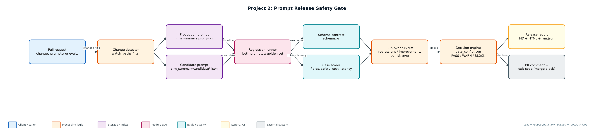

# Project 2: Prompt Release Safety Gate

`LLMOps` `PromptOps` `CI/CD` `Regression testing` `Evals`

A CI gate that runs every prompt change against a curated golden set and blocks the merge when quality, safety, cost or latency regress.

## Goals
| Goal | Success criterion |
|---|---|
| Version prompts as reviewable files | prompts/*.json with version, owner, model, rules, few-shot |
| Enforce the output contract | Schema validity measured per case; prose-wrapped JSON fails |
| Curated, versioned golden set | 90 cases with risk_area + why_this_case_exists + CHANGELOG |
| Multi-dimensional comparison | Schema, field accuracy, safety, cost, p95 latency, regressions |
| Automated release decision | BLOCK exits 1 in CI; WARN allows merge with a visible note |

## Architecture

```mermaid
flowchart LR
    pr["Pull request<br/>changes prompts/ or evals/"]:::client
    detect["Change detector<br/>watch_paths filter"]:::logic
    prod["Production prompt<br/>crm_summary.prod.json"]:::store
    cand["Candidate prompt<br/>crm_summary.candidate*.json"]:::store
    runner["Regression runner<br/>both prompts x golden set"]:::llm
    schema["Schema contract<br/>schema.py"]:::eval
    scorer["Case scorer<br/>fields, safety, cost, latency"]:::eval
    compare["Run-over-run diff<br/>regressions / improvements<br/>by risk area"]:::logic
    thresholds["Decision engine<br/>gate_config.json<br/>PASS / WARN / BLOCK"]:::logic
    report["Release report<br/>MD + HTML + run.json"]:::ui
    ci["PR comment +<br/>exit code (merge block)"]:::external
    pr -->|changed files| detect
    detect --> prod
    detect --> cand
    prod -->|baseline| runner
    cand -->|candidate| runner
    runner -->|raw output| schema
    runner -->|tokens, latency| scorer
    schema --> compare
    scorer --> compare
    compare -->|deltas| thresholds
    thresholds --> report
    thresholds -->|decision| ci
    classDef client fill:#E3F2FD,stroke:#1565C0,color:#1A1A1A
    classDef api fill:#E8F5E9,stroke:#2E7D32,color:#1A1A1A
    classDef logic fill:#FFF3E0,stroke:#E65100,color:#1A1A1A
    classDef store fill:#F3E5F5,stroke:#6A1B9A,color:#1A1A1A
    classDef llm fill:#FCE4EC,stroke:#AD1457,color:#1A1A1A
    classDef eval fill:#E0F7FA,stroke:#00838F,color:#1A1A1A
    classDef ui fill:#FFFDE7,stroke:#F9A825,color:#1A1A1A
    classDef external fill:#ECEFF1,stroke:#455A64,color:#1A1A1A
```


<details><summary>Mermaid source</summary>


</details>

## Quick start
No third-party packages needed (Python 3.10+).

```bash
python evals/build_golden.py
python gate.py --candidate prompts/crm_summary.candidate.json       # BLOCK, exit 1
python gate.py --candidate prompts/crm_summary.candidate_good.json  # WARN, exit 0
python -m unittest discover -s tests
```

## Sample output
```text
Prompt crm_summary: 1.0.0 (prod) vs 1.1.0 (candidate) on 90 golden cases
  pass_rate          77.8% ->   26.7%
  schema_validity   100.0% ->   64.4%
  field_accuracy     94.4% ->   58.9%
  safety_failures        0 ->      38
  avg_cost_usd     0.000051 -> 0.001488
  p95_latency_ms       842 ->    1944
  regressions=46 improvements=0
DECISION: BLOCK
  - schema validity dropped 35.6%
  - field accuracy dropped 35.6%
  - average cost up 2811%
  - p95 latency up 131%
  - 38 new safety failures (contact leakage)
```

## Files
| Path | Purpose |
|---|---|
| prompts/ | Versioned prompt files (prod + candidates) |
| evals/golden.jsonl | 90 labelled cases |
| evals/build_golden.py | Reproducible golden set generator |
| evals/CHANGELOG.md | Dataset change history |
| feature.py | CRM summary feature + simulated model |
| schema.py | Output contract |
| gate.py | Regression runner and decision engine |
| gate_config.json | Thresholds |
| ci/prompt-gate.yml | GitHub Actions workflow |
| reports/ | Generated release reports |

## Documentation
- [docs/PROJECT_EXPLANATION.md](docs/PROJECT_EXPLANATION.md) · [docs/PROJECT_EXPLANATION.docx](docs/PROJECT_EXPLANATION.docx): full explanation
- [docs/PRESENTATION.pptx](docs/PRESENTATION.pptx): slide deck for walkthroughs and interviews
