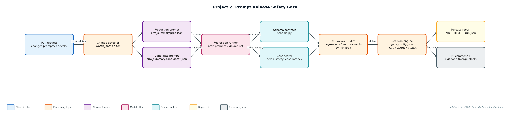

# Project 2: Prompt Release Safety Gate

**Primary topic:** LLMOps · **Secondary:** PromptOps, CI/CD, Regression testing, Evals

> A CI gate that runs every prompt change against a curated golden set and blocks the merge when quality, safety, cost or latency regress.

## 1. Problem
Prompts are production code, but most teams edit them in place and find regressions from customer complaints. A 'friendlier' prompt can silently break the JSON contract, leak contact details into the CRM, and multiply cost.

### Why it matters
- Prompt edits change behaviour as much as code changes do, without any compiler to catch mistakes.
- Averages hide damage: risk-area breakdowns show which kind of case regressed.
- Cost and latency are release criteria too, not only accuracy.
- A PR comment with a clear PASS / WARN / BLOCK decision changes team behaviour.

## 2. Goals and success criteria
| Goal | Success criterion |
|---|---|
| Version prompts as reviewable files | prompts/*.json with version, owner, model, rules, few-shot |
| Enforce the output contract | Schema validity measured per case; prose-wrapped JSON fails |
| Curated, versioned golden set | 90 cases with risk_area + why_this_case_exists + CHANGELOG |
| Multi-dimensional comparison | Schema, field accuracy, safety, cost, p95 latency, regressions |
| Automated release decision | BLOCK exits 1 in CI; WARN allows merge with a visible note |

### Non-goals
- Choosing the best prompt automatically (the gate decides safe vs unsafe, humans choose).
- LLM-as-judge for summaries in V1; deterministic field checks come first.

## 3. Architecture

```mermaid
flowchart LR
    pr["Pull request<br/>changes prompts/ or evals/"]:::client
    detect["Change detector<br/>watch_paths filter"]:::logic
    prod["Production prompt<br/>crm_summary.prod.json"]:::store
    cand["Candidate prompt<br/>crm_summary.candidate*.json"]:::store
    runner["Regression runner<br/>both prompts x golden set"]:::llm
    schema["Schema contract<br/>schema.py"]:::eval
    scorer["Case scorer<br/>fields, safety, cost, latency"]:::eval
    compare["Run-over-run diff<br/>regressions / improvements<br/>by risk area"]:::logic
    thresholds["Decision engine<br/>gate_config.json<br/>PASS / WARN / BLOCK"]:::logic
    report["Release report<br/>MD + HTML + run.json"]:::ui
    ci["PR comment +<br/>exit code (merge block)"]:::external
    pr -->|changed files| detect
    detect --> prod
    detect --> cand
    prod -->|baseline| runner
    cand -->|candidate| runner
    runner -->|raw output| schema
    runner -->|tokens, latency| scorer
    schema --> compare
    scorer --> compare
    compare -->|deltas| thresholds
    thresholds --> report
    thresholds -->|decision| ci
    classDef client fill:#E3F2FD,stroke:#1565C0,color:#1A1A1A
    classDef api fill:#E8F5E9,stroke:#2E7D32,color:#1A1A1A
    classDef logic fill:#FFF3E0,stroke:#E65100,color:#1A1A1A
    classDef store fill:#F3E5F5,stroke:#6A1B9A,color:#1A1A1A
    classDef llm fill:#FCE4EC,stroke:#AD1457,color:#1A1A1A
    classDef eval fill:#E0F7FA,stroke:#00838F,color:#1A1A1A
    classDef ui fill:#FFFDE7,stroke:#F9A825,color:#1A1A1A
    classDef external fill:#ECEFF1,stroke:#455A64,color:#1A1A1A
```




### Components
| Component | File | Responsibility |
|---|---|---|
| AI feature | feature.py | Note -> CRM JSON. Deterministic simulated model that follows the prompt's rules; swap for a provider adapter. |
| Response contract | schema.py | Validates JSON shape, enums, confidence range and summary length. |
| Golden set builder | evals/build_golden.py | Seeded, labelled cases with risk_area, difficulty and rationale; versioned with a changelog. |
| Gate | gate.py | Runs baseline + candidate, scores cases, computes deltas, applies thresholds, writes reports, sets exit code. |
| Thresholds | gate_config.json | Warn and block limits for schema, accuracy, safety, cost and latency. |
| CI workflow | ci/prompt-gate.yml | GitHub Actions job: run gate, post sticky PR comment, upload report artifact. |

## 4. Request / data flow
1. A PR touches prompts/ or evals/; the change detector decides whether the gate must run.
2. The runner calls the production and candidate prompts on all 90 golden cases and records raw output, tokens, latency and cost.
3. Each output is validated against the CRM schema; invalid JSON or prose-wrapped JSON fails the case.
4. Fields (sentiment, urgency, next action, summary keywords) are scored and contact leakage is checked.
5. Results are diffed case by case: passed-before-failing-now cases become the regression list, grouped by risk area.
6. The decision engine compares deltas with warn/block thresholds and produces PASS, WARN or BLOCK with reasons.
7. Reports are written (Markdown, HTML, JSON, PR comment) and the process exits 1 on BLOCK so the PR cannot merge.

## 5. Key design decisions
| Decision | Why | Trade-off |
|---|---|---|
| The dataset is the product | Hand-labelled edge cases (PII, typos, urgency) are what make the gate meaningful. | Needs ownership and a changelog to avoid rot. |
| Separate warn and block thresholds | Small cost increases should be visible, not merge-blocking. | Two sets of numbers to agree on with the team. |
| Do not collapse into one score | A single score hides a safety regression behind an accuracy gain. | Longer reports; mitigated by a short PR comment. |
| Deterministic checks before judges | Schema and leakage checks are cheap, exact and explainable. | Summary quality needs an LLM judge later. |
| Run only on relevant paths | Keeps CI fast and cheap. | Shared code changes need an explicit trigger. |

## 6. Evaluation and metrics
- Pass rate, schema validity, field accuracy (4 fields per case), safety failures, average cost, p95 latency.
- Pass rate by risk area: pii, typo, urgency, routine.
- Regression and improvement lists with baseline vs candidate output side by side.
- Demo: the 'friendlier' candidate is blocked; a typo-tolerant candidate improves pass rate to 100% with a cost warning.

## 7. How to run
```bash
python evals/build_golden.py
python gate.py --candidate prompts/crm_summary.candidate.json       # BLOCK, exit 1
python gate.py --candidate prompts/crm_summary.candidate_good.json  # WARN, exit 0
python -m unittest discover -s tests
```

### Sample output
`python3 gate.py --candidate prompts/crm_summary.candidate.json`

```text
Prompt crm_summary: 1.0.0 (prod) vs 1.1.0 (candidate) on 90 golden cases
  pass_rate          77.8% ->   26.7%
  schema_validity   100.0% ->   64.4%
  field_accuracy     94.4% ->   58.9%
  safety_failures        0 ->      38
  avg_cost_usd     0.000051 -> 0.001488
  p95_latency_ms       842 ->    1944
  regressions=46 improvements=0
DECISION: BLOCK
  - schema validity dropped 35.6%
  - field accuracy dropped 35.6%
  - average cost up 2811%
  - p95 latency up 131%
  - 38 new safety failures (contact leakage)
```

## 8. Project structure
| Path | Purpose |
|---|---|
| prompts/ | Versioned prompt files (prod + candidates) |
| evals/golden.jsonl | 90 labelled cases |
| evals/build_golden.py | Reproducible golden set generator |
| evals/CHANGELOG.md | Dataset change history |
| feature.py | CRM summary feature + simulated model |
| schema.py | Output contract |
| gate.py | Regression runner and decision engine |
| gate_config.json | Thresholds |
| ci/prompt-gate.yml | GitHub Actions workflow |
| reports/ | Generated release reports |

## 9. Interview talking points
- The golden set is the real product; the runner is plumbing. Every case says why it exists.
- The blocked candidate looked better to a human: warmer and more detailed. The gate showed it broke JSON 36% of the time and leaked contacts.
- Cost is a release metric: the candidate also switched to a bigger model and was ~28x more expensive per call.
- WARN vs BLOCK keeps the gate trusted: if it blocks too often, people bypass it.
- Rollback is trivial because prompts are versioned files and production points at one version.

## 10. Production roadmap
- Replace the simulated model with real provider calls and cache responses by (prompt hash, case id).
- Add an LLM-as-judge for summary relevance with a calibration set (see Project 14).
- Store runs in SQLite/Postgres and trend metrics per prompt version.
- Post the Slack summary on BLOCK and require an owner override label to merge.

## 11. Resume bullet
> Built a prompt release safety gate in CI that compares production and candidate prompts on a 90-case risk-labelled golden set and blocks merges on schema, safety, cost or latency regressions (caught a candidate with 38 PII leaks and 28x cost).
