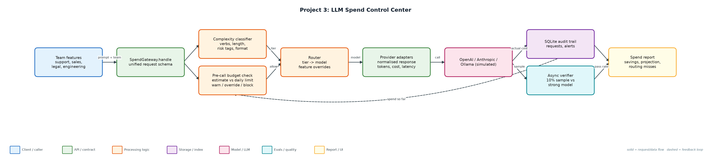

# Project 3: LLM Spend Control Center

`LLMOps` `Cost optimisation` `Model routing` `Budgets` `Observability`

A gateway in front of every LLM call that routes by complexity, enforces team budgets before the call, and proves the savings did not cost quality.

## Goals
| Goal | Success criterion |
|---|---|
| Single gateway contract | One request/response schema across OpenAI, Anthropic and local models |
| Complexity-based routing | Tier 1-3 classifier with feature overrides in config |
| Budget enforcement | Warn at 80%, block low priority at 100%, override for normal/high |
| Quality-safe savings | 10% async verification sample; routing misses recorded |
| Cost visibility | Spend by team/feature, projection, savings vs all-strong counterfactual |

## Architecture

```mermaid
flowchart LR
    apps["Team features<br/>support, sales,<br/>legal, engineering"]:::client
    gateway["SpendGateway.handle<br/>unified request schema"]:::api
    classifier["Complexity classifier<br/>verbs, length,<br/>risk tags, format"]:::logic
    budget["Pre-call budget check<br/>estimate vs daily limit<br/>warn / override / block"]:::logic
    router["Router<br/>tier -> model<br/>feature overrides"]:::logic
    adapters["Provider adapters<br/>normalised response<br/>tokens, cost, latency"]:::api
    providers["OpenAI / Anthropic /<br/>Ollama (simulated)"]:::llm
    audit["SQLite audit trail<br/>requests, alerts"]:::store
    verifier["Async verifier<br/>10% sample vs<br/>strong model"]:::eval
    report["Spend report<br/>savings, projection,<br/>routing misses"]:::ui
    apps -->|prompt + team| gateway
    gateway --> classifier
    gateway --> budget
    classifier -->|tier| router
    budget -->|allow| router
    router -->|model| adapters
    adapters -->|call| providers
    providers -->|actual cost| audit
    providers -->|sample| verifier
    audit --> report
    verifier -->|pass rate| report
    audit -->|spend so far| budget
    classDef client fill:#E3F2FD,stroke:#1565C0,color:#1A1A1A
    classDef api fill:#E8F5E9,stroke:#2E7D32,color:#1A1A1A
    classDef logic fill:#FFF3E0,stroke:#E65100,color:#1A1A1A
    classDef store fill:#F3E5F5,stroke:#6A1B9A,color:#1A1A1A
    classDef llm fill:#FCE4EC,stroke:#AD1457,color:#1A1A1A
    classDef eval fill:#E0F7FA,stroke:#00838F,color:#1A1A1A
    classDef ui fill:#FFFDE7,stroke:#F9A825,color:#1A1A1A
    classDef external fill:#ECEFF1,stroke:#455A64,color:#1A1A1A
```


<details><summary>Mermaid source</summary>


</details>

## Quick start
No third-party packages needed (Python 3.10+).

```bash
python simulate.py --requests 1000
sqlite3 reports/spend.db 'select team, round(sum(cost_usd),4) from requests group by team'
python -m unittest discover -s tests
```

## Sample output
```text
# LLM spend report (1000 simulated requests over 3 days)

- Served: 981 · blocked by budget: 19 · budget overrides: 60
- Actual spend: $0.8814 · all-claude-sonnet counterfactual: $2.6691 · **savings 67.0%**
- Monthly projection at this rate: $8.81
- Verifier pass rate: 89.1% on 92 sampled cheap-model responses
- Escalation rate: 1.4%

## Spend by team
...
Full report: reports/spend_report.md  ·  audit trail: reports/spend.db
```

## Files
| Path | Purpose |
|---|---|
| classifier.py | Tier classifier |
| gateway.py | Gateway, budgets, escalation, audit |
| providers.py | Provider adapters + simulated quality oracle |
| config/ | Routing and budget configuration |
| simulate.py | Workload simulation and spend report |
| reports/ | spend_report.md and spend.db (generated) |
| tests/ | Unit tests |

## Documentation
- [docs/PROJECT_EXPLANATION.md](docs/PROJECT_EXPLANATION.md) · [docs/PROJECT_EXPLANATION.docx](docs/PROJECT_EXPLANATION.docx): full explanation
- [docs/PRESENTATION.pptx](docs/PRESENTATION.pptx): slide deck for walkthroughs and interviews
