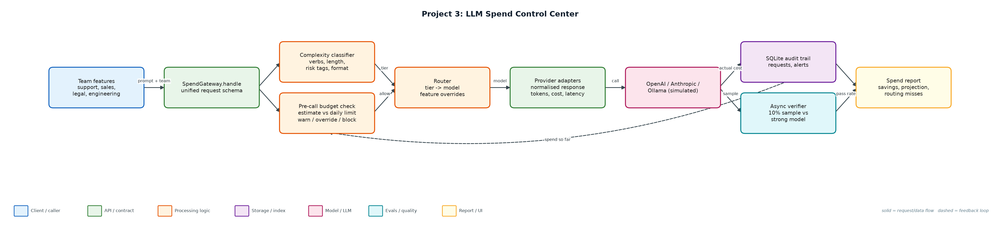

# Project 3: LLM Spend Control Center

**Primary topic:** LLMOps · **Secondary:** Cost optimisation, Model routing, Budgets, Observability

> A gateway in front of every LLM call that routes by complexity, enforces team budgets before the call, and proves the savings did not cost quality.

## 1. Problem
Once several teams ship AI features, every request defaults to the strongest model, nobody owns the bill, and finance finds out at month end. Cutting cost blindly breaks quality; nobody can show which requests actually needed the expensive model.

### Why it matters
- Most traffic is extraction, formatting and classification, which cheap models handle well.
- Budgets must be enforced before the provider call, but the true cost is only known after it.
- Savings claims are only credible with a quality check on the cheap path.
- Per-team and per-feature attribution turns cost into an engineering metric.

## 2. Goals and success criteria
| Goal | Success criterion |
|---|---|
| Single gateway contract | One request/response schema across OpenAI, Anthropic and local models |
| Complexity-based routing | Tier 1-3 classifier with feature overrides in config |
| Budget enforcement | Warn at 80%, block low priority at 100%, override for normal/high |
| Quality-safe savings | 10% async verification sample; routing misses recorded |
| Cost visibility | Spend by team/feature, projection, savings vs all-strong counterfactual |

### Non-goals
- Learning the router from data in V1 (heuristic tiers first, measured by the verifier).
- Real-time Grafana; the dashboard is a generated report over the SQLite audit trail.

## 3. Architecture

```mermaid
flowchart LR
    apps["Team features<br/>support, sales,<br/>legal, engineering"]:::client
    gateway["SpendGateway.handle<br/>unified request schema"]:::api
    classifier["Complexity classifier<br/>verbs, length,<br/>risk tags, format"]:::logic
    budget["Pre-call budget check<br/>estimate vs daily limit<br/>warn / override / block"]:::logic
    router["Router<br/>tier -> model<br/>feature overrides"]:::logic
    adapters["Provider adapters<br/>normalised response<br/>tokens, cost, latency"]:::api
    providers["OpenAI / Anthropic /<br/>Ollama (simulated)"]:::llm
    audit["SQLite audit trail<br/>requests, alerts"]:::store
    verifier["Async verifier<br/>10% sample vs<br/>strong model"]:::eval
    report["Spend report<br/>savings, projection,<br/>routing misses"]:::ui
    apps -->|prompt + team| gateway
    gateway --> classifier
    gateway --> budget
    classifier -->|tier| router
    budget -->|allow| router
    router -->|model| adapters
    adapters -->|call| providers
    providers -->|actual cost| audit
    providers -->|sample| verifier
    audit --> report
    verifier -->|pass rate| report
    audit -->|spend so far| budget
    classDef client fill:#E3F2FD,stroke:#1565C0,color:#1A1A1A
    classDef api fill:#E8F5E9,stroke:#2E7D32,color:#1A1A1A
    classDef logic fill:#FFF3E0,stroke:#E65100,color:#1A1A1A
    classDef store fill:#F3E5F5,stroke:#6A1B9A,color:#1A1A1A
    classDef llm fill:#FCE4EC,stroke:#AD1457,color:#1A1A1A
    classDef eval fill:#E0F7FA,stroke:#00838F,color:#1A1A1A
    classDef ui fill:#FFFDE7,stroke:#F9A825,color:#1A1A1A
    classDef external fill:#ECEFF1,stroke:#455A64,color:#1A1A1A
```




### Components
| Component | File | Responsibility |
|---|---|---|
| Classifier | classifier.py | Assigns tier 1-3 from instruction verbs, context length, output format and risk tags. |
| Gateway | gateway.py | Routing, pre-call budget enforcement, escalation for high-priority low-confidence answers, audit logging. |
| Provider adapters | providers.py | Normalised responses; simulated provider uses registry prices, latency and a quality model. |
| Model registry | ../common/pricing.py | Model name, provider, tier, input/output price, latency profile, quality. |
| Config | config/routing.json, config/budgets.json | Tier mapping, overrides, sample rate, team budgets. |
| Simulation & report | simulate.py | Seeded 1,000-request workload and spend report over the audit DB. |

## 4. Request / data flow
1. A feature sends prompt, team, feature, priority and risk tags to the gateway.
2. The classifier assigns a tier and records why (verb, length, risk tag, output format).
3. The router maps tier to a model unless a feature override (e.g. contract_review) pins a stronger one.
4. The budget check estimates the cost and compares spend-so-far + estimate with the team's daily limit.
5. Over the limit: low priority is blocked with a clear error; normal/high is served and flagged as an override. At 80% an alert fires once per team per day.
6. The provider adapter returns text, tokens, latency and actual cost; high-priority low-confidence answers are escalated to the strong model.
7. Every request is written to the audit table; 10% of cheap-model responses are verified against the strong model and misses are recorded.
8. The report aggregates spend, projection, model mix, latency, verifier pass rate, routing misses and alerts.

## 5. Key design decisions
| Decision | Why | Trade-off |
|---|---|---|
| Enforce on estimate, settle on actual | Blocking must happen before money is spent. | Estimates can be wrong; reconcile from the audit log. |
| Priority-aware blocking | Low-priority batch work can wait; customer-facing work should not fail. | Overrides can exceed budgets; they are flagged and alerted. |
| Heuristic router + verifier | Explainable routing now, measured quality, data to train a router later. | Heuristics miss hidden difficulty (seen as routing misses). |
| Feature overrides in config | Some features (legal) must always use the strongest model. | Overrides reduce savings; visible per feature. |
| Counterfactual savings | Compare with 'everything on the strongest model' using the same tokens. | Assumes equal token counts across models. |

## 6. Evaluation and metrics
- Savings vs all-strong counterfactual on the same workload (67% in the seeded simulation).
- Verifier pass rate on sampled cheap-model responses (~89%) and a list of routing misses.
- Blocked requests, budget overrides and alerts per team per day.
- p50/p95 latency per model and escalation rate.

## 7. How to run
```bash
python simulate.py --requests 1000
sqlite3 reports/spend.db 'select team, round(sum(cost_usd),4) from requests group by team'
python -m unittest discover -s tests
```

### Sample output
`python3 simulate.py --requests 1000`

```text
# LLM spend report (1000 simulated requests over 3 days)

- Served: 981 · blocked by budget: 19 · budget overrides: 60
- Actual spend: $0.8814 · all-claude-sonnet counterfactual: $2.6691 · **savings 67.0%**
- Monthly projection at this rate: $8.81
- Verifier pass rate: 89.1% on 92 sampled cheap-model responses
- Escalation rate: 1.4%

## Spend by team
...
Full report: reports/spend_report.md  ·  audit trail: reports/spend.db
```

## 8. Project structure
| Path | Purpose |
|---|---|
| classifier.py | Tier classifier |
| gateway.py | Gateway, budgets, escalation, audit |
| providers.py | Provider adapters + simulated quality oracle |
| config/ | Routing and budget configuration |
| simulate.py | Workload simulation and spend report |
| reports/ | spend_report.md and spend.db (generated) |
| tests/ | Unit tests |

## 9. Interview talking points
- Budgets are enforced before the call, but the final cost is only known after the response; the audit log reconciles the two.
- Savings without a quality check is not a result. The verifier shows the cheap path passes ~89% of sampled checks and lists the misses.
- Routing misses are training data for a learned router later.
- Priority matters: low-priority work is blocked, customer-facing work is served and flagged.
- Per-feature attribution showed contract_review and log_triage dominate spend, which is where optimisation effort should go.

## 10. Production roadmap
- Expose the gateway as a FastAPI proxy with OpenAI-compatible endpoints; move counters to Redis.
- Move verification to Celery/RQ workers and alert to Slack.
- Train a small classifier on logged features + verifier outcomes to replace the heuristics.
- Grafana dashboard on Postgres with monthly projections and anomaly alerts.

## 11. Resume bullet
> Built an LLM spend gateway with complexity-based routing, pre-call team budgets and sampled quality verification; cut simulated spend 67% vs an all-strong-model baseline with an ~89% verifier pass rate.
