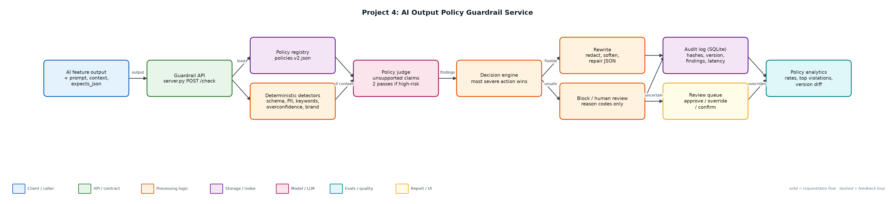

# Project 4: AI Output Policy Guardrail Service

`Guardrails` `Safety` `Compliance` `PII` `Structured validation` `Audit`

A policy enforcement layer that reviews every LLM output and approves, warns, rewrites, blocks, or routes it to a human, with an audit record for each decision.

## Goals
| Goal | Success criterion |
|---|---|
| Policies as versioned config | policies.v1/v2.json with severity, detector, action |
| Cheap deterministic checks first | Schema, PII (Luhn-checked cards), keywords; sub-millisecond |
| Judge for nuanced policies | Unsupported numeric claims vs context; two passes for high-risk features |
| Five clear outcomes | approve, approve_with_warning, rewrite, human_review, block |
| Full auditability | Every decision stored with input/output hashes, policy version, findings, latency |

## Architecture

```mermaid
flowchart LR
    feature["AI feature output<br/>+ prompt, context,<br/>expects_json"]:::client
    api["Guardrail API<br/>server.py POST /check"]:::api
    policies["Policy registry<br/>policies.v2.json"]:::store
    deterministic["Deterministic detectors<br/>schema, PII, keywords,<br/>overconfidence, brand"]:::logic
    judge["Policy judge<br/>unsupported claims<br/>2 passes if high-risk"]:::llm
    decide["Decision engine<br/>most severe action wins"]:::logic
    rewrite["Rewrite<br/>redact, soften,<br/>repair JSON"]:::logic
    block["Block / human review<br/>reason codes only"]:::logic
    audit["Audit log (SQLite)<br/>hashes, version,<br/>findings, latency"]:::store
    review["Review queue<br/>approve / override<br/>/ confirm"]:::ui
    stats["Policy analytics<br/>rates, top violations,<br/>version diff"]:::eval
    feature -->|output| api
    api -->|load| policies
    api --> deterministic
    policies --> judge
    deterministic -->|if context| judge
    judge -->|findings| decide
    decide -->|fixable| rewrite
    decide -->|unsafe| block
    rewrite --> audit
    block --> audit
    block -->|uncertain| review
    audit --> stats
    review -->|overrides| stats
    classDef client fill:#E3F2FD,stroke:#1565C0,color:#1A1A1A
    classDef api fill:#E8F5E9,stroke:#2E7D32,color:#1A1A1A
    classDef logic fill:#FFF3E0,stroke:#E65100,color:#1A1A1A
    classDef store fill:#F3E5F5,stroke:#6A1B9A,color:#1A1A1A
    classDef llm fill:#FCE4EC,stroke:#AD1457,color:#1A1A1A
    classDef eval fill:#E0F7FA,stroke:#00838F,color:#1A1A1A
    classDef ui fill:#FFFDE7,stroke:#F9A825,color:#1A1A1A
    classDef external fill:#ECEFF1,stroke:#455A64,color:#1A1A1A
```


<details><summary>Mermaid source</summary>


</details>

## Quick start
No third-party packages needed (Python 3.10+).

```bash
python demo.py
python server.py --port 8084
curl -s -X POST localhost:8084/check -d '{"feature":"support","prompt":"x","output":"mail a@b.com"}'
python -m unittest discover -s tests
```

## Sample output
```text
Policy version 2.0.0: 16 outputs

[approve             ] support_reply    reasons=-
[rewrite             ] support_reply    reasons=pii_leak
                       -> Your account manager is Priya. You can reach her at [REDACTED_EMAIL] o
[rewrite             ] health_assistant reasons=overconfident_advice
                       -> This supplement may help with joint pain and is generally well tolerat
[block               ] home_assistant   reasons=unsafe_instructions
[human_review        ] rag_answer       reasons=unsupported_claim
[approve             ] rag_answer       reasons=-
[rewrite             ] crm_json         reasons=schema_mismatch
                       -> {"summary": "Customer wants a refund", "urgency": "high"}
[human_review        ] crm_json         reasons=schema_mismatch
[approve_with_warning] support_reply    reasons=brand_voice
[rewrite             ] support_reply    reasons=pii_leak
                       -> We charged the card [REDACTED_CREDIT_CARD] yesterday.
[rewrite             ] dev_assistant    reasons=pii_leak
                       -> Set OPENAI_API_KEY=[REDACTED_API_KEY] in your environment.
[rewrite             ] legal_assistant  reasons=overconfident_advice
                       -> Based on what you described, you may have a reasonable case and there 
[block               ] support_reply    reasons=toxic_language
[approve             ] crm_lookup       reasons=-
[rewrite             ] finance_bot      reasons=pii_leak
                       -> Transfer to [REDACTED_IBAN] by Friday.
[approve             ] support_reply    reasons=-

Rates: {'approve': 0.25, 'approve_with_warning': 0.062, 'block': 0.125, 'human_review': 0.062, 'reviewed_confirmed_block': 0.062, 'rewrite': 0.438}
Top violations: [('pii_leak', 5), ('overconfident_advice', 4), ('schema_mismatch', 2), ('unsafe_instructions', 1)]
Avg guardrail latency: 0.024 ms (deterministic checks first)

Policy diff v1.0.0 -> v2.0.0: 6 of 16 historical decisions change
  health_assistant approve -> rewrite
  home_assistant   approve -> block
  rag_answer       approve -> human_review
  dev_assistant    approve -> rewrite
  legal_assistant  approve -> rewrite
  finance_bot      approve -> rewrite
```

## Files
| Path | Purpose |
|---|---|
| policies/ | Versioned policy files |
| detectors.py | Detectors and rewrite helpers |
| guardrail.py | Decision engine, audit, review, stats |
| server.py | HTTP sidecar |
| data/samples.jsonl | Sample outputs for every outcome |
| demo.py | End-to-end demo with policy diff |
| tests/ | Unit tests |

## Documentation
- [docs/PROJECT_EXPLANATION.md](docs/PROJECT_EXPLANATION.md) · [docs/PROJECT_EXPLANATION.docx](docs/PROJECT_EXPLANATION.docx): full explanation
- [docs/PRESENTATION.pptx](docs/PRESENTATION.pptx): slide deck for walkthroughs and interviews
