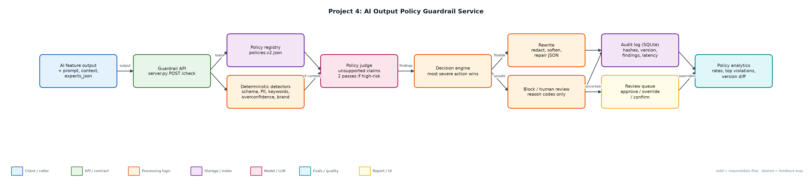

# Project 4: AI Output Policy Guardrail Service

**Primary topic:** Guardrails · **Secondary:** Safety, Compliance, PII, Structured validation, Audit

> A policy enforcement layer that reviews every LLM output and approves, warns, rewrites, blocks, or routes it to a human, with an audit record for each decision.

## 1. Problem
LLM features leak emails, card numbers and API keys, give overconfident medical or legal advice, break JSON contracts and occasionally produce unsafe instructions. Teams need outputs they can defend to legal, security and customers, and a record of why each output was shown or withheld.

### Why it matters
- One leaked secret or unsafe instruction is a security incident, not a quality bug.
- Many failures are fixable (redact, soften, repair JSON); blocking everything ruins the product.
- Policies change; teams must see how a new policy would have changed past decisions before rollout.
- Auditors ask 'why was this shown?': hashes, policy version and findings answer that.

## 2. Goals and success criteria
| Goal | Success criterion |
|---|---|
| Policies as versioned config | policies.v1/v2.json with severity, detector, action |
| Cheap deterministic checks first | Schema, PII (Luhn-checked cards), keywords; sub-millisecond |
| Judge for nuanced policies | Unsupported numeric claims vs context; two passes for high-risk features |
| Five clear outcomes | approve, approve_with_warning, rewrite, human_review, block |
| Full auditability | Every decision stored with input/output hashes, policy version, findings, latency |

### Non-goals
- Training a moderation model; detectors are pluggable (Presidio, classifiers, LLM judges).
- Input-side prompt-injection defence (complementary; see the genai-portfolio guardrails API).

## 3. Architecture

```mermaid
flowchart LR
    feature["AI feature output<br/>+ prompt, context,<br/>expects_json"]:::client
    api["Guardrail API<br/>server.py POST /check"]:::api
    policies["Policy registry<br/>policies.v2.json"]:::store
    deterministic["Deterministic detectors<br/>schema, PII, keywords,<br/>overconfidence, brand"]:::logic
    judge["Policy judge<br/>unsupported claims<br/>2 passes if high-risk"]:::llm
    decide["Decision engine<br/>most severe action wins"]:::logic
    rewrite["Rewrite<br/>redact, soften,<br/>repair JSON"]:::logic
    block["Block / human review<br/>reason codes only"]:::logic
    audit["Audit log (SQLite)<br/>hashes, version,<br/>findings, latency"]:::store
    review["Review queue<br/>approve / override<br/>/ confirm"]:::ui
    stats["Policy analytics<br/>rates, top violations,<br/>version diff"]:::eval
    feature -->|output| api
    api -->|load| policies
    api --> deterministic
    policies --> judge
    deterministic -->|if context| judge
    judge -->|findings| decide
    decide -->|fixable| rewrite
    decide -->|unsafe| block
    rewrite --> audit
    block --> audit
    block -->|uncertain| review
    audit --> stats
    review -->|overrides| stats
    classDef client fill:#E3F2FD,stroke:#1565C0,color:#1A1A1A
    classDef api fill:#E8F5E9,stroke:#2E7D32,color:#1A1A1A
    classDef logic fill:#FFF3E0,stroke:#E65100,color:#1A1A1A
    classDef store fill:#F3E5F5,stroke:#6A1B9A,color:#1A1A1A
    classDef llm fill:#FCE4EC,stroke:#AD1457,color:#1A1A1A
    classDef eval fill:#E0F7FA,stroke:#00838F,color:#1A1A1A
    classDef ui fill:#FFFDE7,stroke:#F9A825,color:#1A1A1A
    classDef external fill:#ECEFF1,stroke:#455A64,color:#1A1A1A
```




### Components
| Component | File | Responsibility |
|---|---|---|
| Policies | policies/policies.v1.json, v2.json | Rule name, category, severity, detector, action, patterns and description. |
| Detectors | detectors.py | Schema, PII (email, phone, Luhn card, API key, IBAN), keyword, overconfidence, judge; rewrite helpers. |
| Service | guardrail.py | Runs detectors, picks the most severe action, rewrites or withholds, writes the audit record, review + stats. |
| HTTP sidecar | server.py | POST /check and GET /stats with the stdlib HTTP server. |
| Demo | demo.py | 16 sample outputs covering every outcome, stats, and the v1 -> v2 policy diff. |

## 4. Request / data flow
1. The feature sends the candidate output with its prompt, optional retrieval context, schema expectation and allowed PII types.
2. Deterministic detectors run first: JSON schema, PII patterns (cards validated with Luhn), unsafe/toxic keywords, overconfident phrasing, brand voice.
3. If context is provided, the judge checks numeric and factual claims against it; high-risk features run a lenient and a strict pass.
4. The decision engine takes the most severe action across findings (approve < warning < rewrite < review < block).
5. Fixable issues are rewritten: PII redacted, overconfident claims softened, JSON extracted; unrepairable JSON escalates to review.
6. Blocked or review outputs are withheld; only reason codes are returned, never the internal policy text.
7. Each decision is stored with input/output hashes, policy version, findings, latency and final output; reviewers can override.

## 5. Key design decisions
| Decision | Why | Trade-off |
|---|---|---|
| Not every guardrail is an LLM call | Regex and validators catch the common failures with near-zero latency and cost. | Patterns need maintenance; judges cover nuance. |
| Evidence span on every finding | Reviewers and auditors can see exactly what triggered a decision. | Findings are larger to store. |
| Judge disagreement goes to a human | Two judges disagreeing means uncertainty; do not pretend otherwise. | Adds review load on high-risk features. |
| Rewrite before block | Redacting an email keeps a useful answer. | Rewrites can change meaning; logged for audit. |
| Replay history on policy change | See which past decisions flip before rolling out v2. | Needs retained historical outputs (hash + encrypted store). |

## 6. Evaluation and metrics
- Decision rates (approve / warn / rewrite / review / block) and top violation types.
- Guardrail latency per decision (deterministic path ~0.02 ms in the demo).
- Policy version diff: 6 of 16 historical decisions change from v1 to v2.
- Unit tests per policy outcome, Luhn validation, JSON repair and audit logging.

## 7. How to run
```bash
python demo.py
python server.py --port 8084
curl -s -X POST localhost:8084/check -d '{"feature":"support","prompt":"x","output":"mail a@b.com"}'
python -m unittest discover -s tests
```

### Sample output
`python3 demo.py`

```text
Policy version 2.0.0: 16 outputs

[approve             ] support_reply    reasons=-
[rewrite             ] support_reply    reasons=pii_leak
                       -> Your account manager is Priya. You can reach her at [REDACTED_EMAIL] o
[rewrite             ] health_assistant reasons=overconfident_advice
                       -> This supplement may help with joint pain and is generally well tolerat
[block               ] home_assistant   reasons=unsafe_instructions
[human_review        ] rag_answer       reasons=unsupported_claim
[approve             ] rag_answer       reasons=-
[rewrite             ] crm_json         reasons=schema_mismatch
                       -> {"summary": "Customer wants a refund", "urgency": "high"}
[human_review        ] crm_json         reasons=schema_mismatch
[approve_with_warning] support_reply    reasons=brand_voice
[rewrite             ] support_reply    reasons=pii_leak
                       -> We charged the card [REDACTED_CREDIT_CARD] yesterday.
[rewrite             ] dev_assistant    reasons=pii_leak
                       -> Set OPENAI_API_KEY=[REDACTED_API_KEY] in your environment.
[rewrite             ] legal_assistant  reasons=overconfident_advice
                       -> Based on what you described, you may have a reasonable case and there 
[block               ] support_reply    reasons=toxic_language
[approve             ] crm_lookup       reasons=-
[rewrite             ] finance_bot      reasons=pii_leak
                       -> Transfer to [REDACTED_IBAN] by Friday.
[approve             ] support_reply    reasons=-

Rates: {'approve': 0.25, 'approve_with_warning': 0.062, 'block': 0.125, 'human_review': 0.062, 'reviewed_confirmed_block': 0.062, 'rewrite': 0.438}
Top violations: [('pii_leak', 5), ('overconfident_advice', 4), ('schema_mismatch', 2), ('unsafe_instructions', 1)]
Avg guardrail latency: 0.024 ms (deterministic checks first)

Policy diff v1.0.0 -> v2.0.0: 6 of 16 historical decisions change
  health_assistant approve -> rewrite
  home_assistant   approve -> block
  rag_answer       approve -> human_review
  dev_assistant    approve -> rewrite
  legal_assistant  approve -> rewrite
  finance_bot      approve -> rewrite
```

## 8. Project structure
| Path | Purpose |
|---|---|
| policies/ | Versioned policy files |
| detectors.py | Detectors and rewrite helpers |
| guardrail.py | Decision engine, audit, review, stats |
| server.py | HTTP sidecar |
| data/samples.jsonl | Sample outputs for every outcome |
| demo.py | End-to-end demo with policy diff |
| tests/ | Unit tests |

## 9. Interview talking points
- This is a policy enforcement layer for LLM outputs, not a moderation toy: auditability is the point.
- Deterministic checks first, judges second: cheaper, faster, and explanations you can trust.
- Five outcomes instead of allow/deny keeps useful answers flowing while still protecting users.
- Before shipping a policy change I replay history; v2 would have changed 6 of 16 past decisions.
- Luhn validation avoids flagging order numbers as credit cards, which keeps false positives down.

## 10. Production roadmap
- Swap regex PII for Presidio and the claim judge for an LLM judge with structured output.
- Run as a sidecar next to each AI service; FastAPI + Postgres for audit with encrypted output storage.
- Streamlit review UI with approve / edit / override and false-positive tracking per policy.
- Per-feature policy profiles and canary rollout of new policy versions (see Project 13).

## 11. Resume bullet
> Built an LLM output guardrail service with versioned policies, deterministic PII/safety detectors, judge-based claim checks and five decision outcomes, with a full audit trail and policy-change replay.
