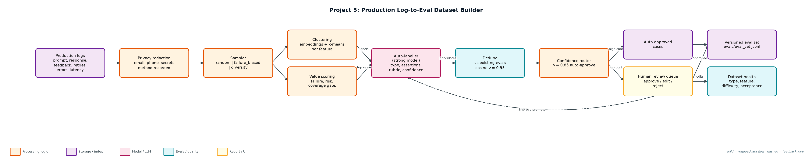

# Project 5: Production Log-to-Eval Dataset Builder

`Evals` `Data flywheel` `LLM-as-judge labelling` `Human review` `Privacy`

A nightly pipeline that mines LLM logs for high-value interactions, turns them into labelled eval cases, and routes uncertain labels to human review.

## Goals
| Goal | Success criterion |
|---|---|
| Unified, redacted log schema | Emails, phones, secrets removed with method recorded per field |
| Risk-aware sampling | random, failure_biased (70% failure quota), diversity modes |
| Discover interaction patterns | Per-feature k-means clusters with readable labels |
| Auto-label with confidence | Golden answer / rubric / expected refusal + assertions |
| Human-in-the-loop dataset | Draft -> approved / rejected; edits tracked; JSONL export |

## Architecture

```mermaid
flowchart LR
    logs["Production logs<br/>prompt, response,<br/>feedback, retries,<br/>errors, latency"]:::store
    redact["Privacy redaction<br/>email, phone, secrets<br/>method recorded"]:::logic
    sampler["Sampler<br/>random | failure_biased<br/>| diversity"]:::logic
    cluster["Clustering<br/>embeddings + k-means<br/>per feature"]:::logic
    scorer["Value scoring<br/>failure, risk,<br/>coverage gaps"]:::logic
    labeller["Auto-labeller<br/>(strong model)<br/>type, assertions,<br/>rubric, confidence"]:::llm
    dedupe["Dedupe<br/>vs existing evals<br/>cosine >= 0.95"]:::eval
    router["Confidence router<br/>>= 0.85 auto-approve"]:::logic
    auto["Auto-approved<br/>cases"]:::store
    review["Human review queue<br/>approve / edit /<br/>reject"]:::ui
    evalset["Versioned eval set<br/>evals/eval_set.jsonl"]:::store
    health["Dataset health<br/>type, feature,<br/>difficulty, acceptance"]:::eval
    logs --> redact
    redact --> sampler
    sampler --> cluster
    sampler --> scorer
    cluster -->|labels| labeller
    scorer -->|top value| labeller
    labeller -->|candidates| dedupe
    dedupe --> router
    router -->|high conf| auto
    router -->|low conf| review
    auto --> evalset
    review -->|approved| evalset
    review -->|edits| health
    review -->|improve prompts| labeller
    classDef client fill:#E3F2FD,stroke:#1565C0,color:#1A1A1A
    classDef api fill:#E8F5E9,stroke:#2E7D32,color:#1A1A1A
    classDef logic fill:#FFF3E0,stroke:#E65100,color:#1A1A1A
    classDef store fill:#F3E5F5,stroke:#6A1B9A,color:#1A1A1A
    classDef llm fill:#FCE4EC,stroke:#AD1457,color:#1A1A1A
    classDef eval fill:#E0F7FA,stroke:#00838F,color:#1A1A1A
    classDef ui fill:#FFFDE7,stroke:#F9A825,color:#1A1A1A
    classDef external fill:#ECEFF1,stroke:#455A64,color:#1A1A1A
```


<details><summary>Mermaid source</summary>


</details>

## Quick start
No third-party packages needed (Python 3.10+).

```bash
python generate_logs.py --n 1000
python build_dataset.py --sample-mode failure_biased --k 400
python build_dataset.py --sample-mode diversity --k 200
python -m unittest discover -s tests
```

## Sample output
```text
Logs: 1000 · redacted: 96 · sample mode: failure_biased (400 picked, 43% failure signals)
Clusters (8):
  [ 78] support_bot:email-charg-twice
  [ 59] support_bot:reset-password-invite
  [ 33] support_bot:download-invoice-urgent
  [ 39] support_bot:refund-20-day
  [ 40] sql_helper:drop-stag-table
  [ 64] sql_helper:order-last-average
  [ 33] summarizer:summarise-incident-report
  [ 54] summarizer:summarise-customer-call
Candidates: 195 · near-duplicates rejected: 66 · kept: 129
Auto-approved (confidence >= 0.85): 24 · sent to review: 105
Review: 98 approved (81 unedited, 17 edited), 7 rejected
Auto-label acceptance after review: 77%
Approved eval set: 122 cases -> evals/eval_set.jsonl
  by type: {'expected_refusal': 24, 'rubric': 98}
  by feature: {'sql_helper': 46, 'support_bot': 53, 'summarizer': 23}
  by difficulty: {'hard': 99, 'normal': 23}
```

## Files
| Path | Purpose |
|---|---|
| generate_logs.py | Synthetic production logs |
| pipeline.py | Pipeline stages |
| build_dataset.py | Orchestrator and health report |
| data/ | logs.jsonl and existing_evals.jsonl |
| evals/ | Exported eval set, review queue, edits, rejections |
| tests/ | Unit tests |

## Documentation
- [docs/PROJECT_EXPLANATION.md](docs/PROJECT_EXPLANATION.md) · [docs/PROJECT_EXPLANATION.docx](docs/PROJECT_EXPLANATION.docx): full explanation
- [docs/PRESENTATION.pptx](docs/PRESENTATION.pptx): slide deck for walkthroughs and interviews
