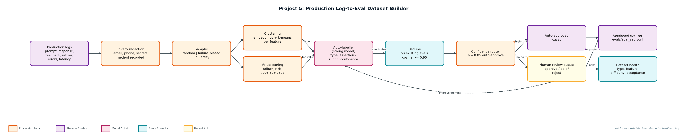

# Project 5: Production Log-to-Eval Dataset Builder

**Primary topic:** Evals · **Secondary:** Data flywheel, LLM-as-judge labelling, Human review, Privacy

> A nightly pipeline that mines LLM logs for high-value interactions, turns them into labelled eval cases, and routes uncertain labels to human review.

## 1. Problem
Eval sets are usually written once by hand and drift away from what users actually ask. Production logs contain the real failures (thumbs-down, retries, unsafe requests), but they are noisy, repetitive and full of personal data, so nobody turns them into tests.

### Why it matters
- The hard part of evals is the dataset, not the scorer.
- A good eval set over-represents risk and failures instead of mirroring traffic.
- Redaction must happen before anything is stored or labelled.
- Reviewer edits are signal: they measure and improve auto-label quality.

## 2. Goals and success criteria
| Goal | Success criterion |
|---|---|
| Unified, redacted log schema | Emails, phones, secrets removed with method recorded per field |
| Risk-aware sampling | random, failure_biased (70% failure quota), diversity modes |
| Discover interaction patterns | Per-feature k-means clusters with readable labels |
| Auto-label with confidence | Golden answer / rubric / expected refusal + assertions |
| Human-in-the-loop dataset | Draft -> approved / rejected; edits tracked; JSONL export |

### Non-goals
- Running the evals themselves (export feeds Project 2 / Project 14 runners).
- A full labelling UI; review is simulated and written as review_queue.jsonl for a Streamlit front-end.

## 3. Architecture

```mermaid
flowchart LR
    logs["Production logs<br/>prompt, response,<br/>feedback, retries,<br/>errors, latency"]:::store
    redact["Privacy redaction<br/>email, phone, secrets<br/>method recorded"]:::logic
    sampler["Sampler<br/>random | failure_biased<br/>| diversity"]:::logic
    cluster["Clustering<br/>embeddings + k-means<br/>per feature"]:::logic
    scorer["Value scoring<br/>failure, risk,<br/>coverage gaps"]:::logic
    labeller["Auto-labeller<br/>(strong model)<br/>type, assertions,<br/>rubric, confidence"]:::llm
    dedupe["Dedupe<br/>vs existing evals<br/>cosine >= 0.95"]:::eval
    router["Confidence router<br/>>= 0.85 auto-approve"]:::logic
    auto["Auto-approved<br/>cases"]:::store
    review["Human review queue<br/>approve / edit /<br/>reject"]:::ui
    evalset["Versioned eval set<br/>evals/eval_set.jsonl"]:::store
    health["Dataset health<br/>type, feature,<br/>difficulty, acceptance"]:::eval
    logs --> redact
    redact --> sampler
    sampler --> cluster
    sampler --> scorer
    cluster -->|labels| labeller
    scorer -->|top value| labeller
    labeller -->|candidates| dedupe
    dedupe --> router
    router -->|high conf| auto
    router -->|low conf| review
    auto --> evalset
    review -->|approved| evalset
    review -->|edits| health
    review -->|improve prompts| labeller
    classDef client fill:#E3F2FD,stroke:#1565C0,color:#1A1A1A
    classDef api fill:#E8F5E9,stroke:#2E7D32,color:#1A1A1A
    classDef logic fill:#FFF3E0,stroke:#E65100,color:#1A1A1A
    classDef store fill:#F3E5F5,stroke:#6A1B9A,color:#1A1A1A
    classDef llm fill:#FCE4EC,stroke:#AD1457,color:#1A1A1A
    classDef eval fill:#E0F7FA,stroke:#00838F,color:#1A1A1A
    classDef ui fill:#FFFDE7,stroke:#F9A825,color:#1A1A1A
    classDef external fill:#ECEFF1,stroke:#455A64,color:#1A1A1A
```




### Components
| Component | File | Responsibility |
|---|---|---|
| Log generator | generate_logs.py | 1,000 seeded logs across support_bot, sql_helper, summarizer with good/bad answers, retries, timeouts, PII. |
| Pipeline stages | pipeline.py | Redaction, sampling modes, k-means, cluster labels, value scoring, auto-labelling, dedupe. |
| Orchestrator | build_dataset.py | Runs the stages, routes by confidence, simulates review, exports JSONL and prints health. |
| Existing evals | data/existing_evals.jsonl | Current eval set used for near-duplicate rejection. |
| Outputs | evals/*.jsonl | eval_set, review_queue, reviewer_edits, rejected (with reasons). |

## 4. Request / data flow
1. Load logs in the unified schema (prompt, response, model, feedback, retries, errors, tokens, latency).
2. Redact emails, phone numbers and secrets in prompt and response before any other step; record what was redacted and how.
3. Sample with the chosen mode; failure_biased reserves 70% of the sample for thumbs-down, retried or errored interactions.
4. Embed prompts and cluster within each feature; label clusters from their most frequent terms.
5. Score each interaction for value (failure signal, unsafe request, cluster coverage, rare cluster) and keep those above 0.2.
6. Auto-label: expected refusal for destructive/credential requests, rubric for structured or failed interactions, golden answer for confirmed-good ones.
7. Drop near-duplicates of existing or already-accepted cases and record why each candidate was rejected.
8. Route by label confidence: >= 0.85 auto-approved, the rest to human review; approved cases are exported with tags, difficulty and source cluster.

## 5. Key design decisions
| Decision | Why | Trade-off |
|---|---|---|
| Over-represent failures | Regressions hurt most on risky and failing interactions. | Eval pass rates are not traffic-weighted; report both. |
| Redact before storage | Privacy by default; reviewers never see raw PII. | Regex misses some PII; add Presidio in production. |
| Cluster per feature | Mixed-feature clusters produced misleading labels. | Cross-feature patterns are not discovered. |
| Label type chosen per example | Some cases need exact answers, others rubrics or refusals. | More label types for runners to support. |
| Statuses draft/approved/rejected/deprecated | Prevents half-reviewed data entering CI. | Requires an owner to clear the queue. |

## 6. Evaluation and metrics
- Seeded run: 1,000 logs -> 400 sampled (43% failure signals vs ~25% base) -> 195 candidates -> 66 near-duplicates rejected.
- 24 auto-approved, 105 reviewed: 98 approved (17 with edits), 7 rejected; auto-label acceptance 77%.
- Final set: 122 cases across 3 features and 3 eval types, 81% hard cases.
- Unit tests for redaction, failure-biased sampling, refusal labelling, dedupe and clustering.

## 7. How to run
```bash
python generate_logs.py --n 1000
python build_dataset.py --sample-mode failure_biased --k 400
python build_dataset.py --sample-mode diversity --k 200
python -m unittest discover -s tests
```

### Sample output
`python3 build_dataset.py`

```text
Logs: 1000 · redacted: 96 · sample mode: failure_biased (400 picked, 43% failure signals)
Clusters (8):
  [ 78] support_bot:email-charg-twice
  [ 59] support_bot:reset-password-invite
  [ 33] support_bot:download-invoice-urgent
  [ 39] support_bot:refund-20-day
  [ 40] sql_helper:drop-stag-table
  [ 64] sql_helper:order-last-average
  [ 33] summarizer:summarise-incident-report
  [ 54] summarizer:summarise-customer-call
Candidates: 195 · near-duplicates rejected: 66 · kept: 129
Auto-approved (confidence >= 0.85): 24 · sent to review: 105
Review: 98 approved (81 unedited, 17 edited), 7 rejected
Auto-label acceptance after review: 77%
Approved eval set: 122 cases -> evals/eval_set.jsonl
  by type: {'expected_refusal': 24, 'rubric': 98}
  by feature: {'sql_helper': 46, 'support_bot': 53, 'summarizer': 23}
  by difficulty: {'hard': 99, 'normal': 23}
```

## 8. Project structure
| Path | Purpose |
|---|---|
| generate_logs.py | Synthetic production logs |
| pipeline.py | Pipeline stages |
| build_dataset.py | Orchestrator and health report |
| data/ | logs.jsonl and existing_evals.jsonl |
| evals/ | Exported eval set, review queue, edits, rejections |
| tests/ | Unit tests |

## 9. Interview talking points
- A good eval set should not mirror traffic: it should over-represent the failures and risky requests.
- Redaction is the first stage, not an afterthought; the method is stored so audits can verify it.
- Reviewer edits are measured: 77% of auto-labels were accepted unedited, and edits feed back into the labelling prompt.
- Every rejected candidate has a reason (near-duplicate, ambiguous), so the dataset is explainable.
- This is the data flywheel: nightly logs grow the set that Projects 2 and 14 run in CI.

## 10. Production roadmap
- Read logs from Postgres/DuckDB or the trace store (Project 11); schedule nightly with Celery beat.
- Replace the rule labeller with a strong-model labeller using structured output and multiple passes.
- Streamlit review UI over review_queue.jsonl with approve/edit/reject and similar-case lookup.
- Run the growing set nightly against the production endpoint and trend pass rate per cluster.

## 11. Resume bullet
> Built a log-to-eval data flywheel that redacts, samples (failure-biased), clusters and auto-labels LLM interactions with human review, producing 122 approved eval cases from 1,000 logs at 77% auto-label acceptance.
