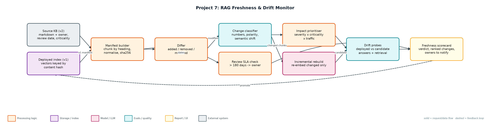
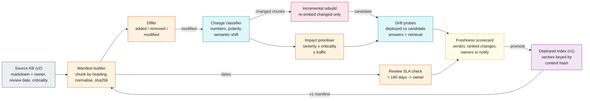

# Project 7: RAG Freshness & Drift Monitor

`RAG` `Data quality` `Observability` `Incremental indexing`

Detects when the deployed RAG index has fallen behind its source documents, ranks changes by business impact, and proves an incremental rebuild fixes the stale answers.

## Goals
| Goal | Success criterion |
|---|---|
| Content manifest with hashes | Per-chunk sha256 of normalised text; whitespace-only edits ignored |
| Classify each change | cosmetic / minor / material using numbers, polarity words, semantic shift |
| Rank by impact | severity x criticality x probe traffic |
| Prove drift with probes | Deployed vs candidate answers; stale answers counted by traffic |
| Cheap incremental rebuild | Re-embed only material/minor/added chunks; report cost avoided |

## Architecture


<details><summary>Mermaid source</summary>


</details>

## Quick start
No third-party packages needed (Python 3.10+).

```bash
python monitor.py
python monitor.py --deployed data/kb_v1 --source data/kb_v2 --today 2026-11-06
python -m unittest discover -s tests
```

## Sample output
```text
Deployed chunks: 9 · source chunks: 9
Changes: 7 (6 material, 0 minor, 1 cosmetic)

Prioritised changes:
  p= 26.1  modified material pricing#plans                      sem=0.018 traffic=190  numeric fact changed ['25 -> 29']
  p= 22.5  modified material refunds#refund-window              sem=0.041 traffic=150  numeric fact changed ['30 -> 14']
  p= 16.2  modified material pricing#annual-billing             sem=0.045 traffic=80   numeric fact changed ['15% -> 20%']
  p=  8.1  modified material sso#scim-provisioning              sem=0.521 traffic=35   polarity words changed: ['not', 'now']
  p=  6.0  added    material data-export#export-api             sem=1.0   traffic=0    new chunk not yet indexed
  p= 4.65  removed  material legacy-export#csv-export           sem=1.0   traffic=55   chunk deleted at source
  p=  0.0  modified cosmetic refunds#how-to-request             sem=0.043 traffic=40   typo / whitespace only

Probes (deployed -> candidate):
  p01 STALE -> fixed drift=answer           How much does the Pro plan cost per user?
  p02 STALE -> fixed drift=answer           What discount do I get for annual billing?
  p03 STALE -> fixed drift=answer           How many days do I have to get a refund on a monthly plan?
  p04 ok    -> ok    drift=answer           How long does it take for refunds to be processed?
  p05 STALE -> fixed drift=answer           Is SCIM user provisioning supported?
  p06 ok    -> ok    drift=-                Which plan includes SAML SSO?
  p07 ok    -> ok    drift=-                What is the API rate limit per minute?
  p08 ok    -> ok    drift=-                How many items does a list endpoint return per page?
  p09 STALE -> fixed drift=retrieval+answer How do I export my workspace data?
  p10 ok    -> ok    drift=-                How much does the Starter plan cost?

Traffic-weighted freshness: 39% deployed -> 100% after incremental rebuild
Incremental rebuild re-embedded 5 of 9 chunks (44% embedding cost avoided)
Docs past review SLA (180 days): sso (identity-team, 340d)
Verdict: REBUILD NOW
Wrote reports/freshness_scorecard.md and reports/source_manifest.json
```

## Files
| Path | Purpose |
|---|---|
| freshness.py | Manifest, diff, change classification |
| drift.py | Vector index and drift probes |
| monitor.py | CLI and scorecard |
| data/ | kb_v1, kb_v2, probes |
| reports/ | freshness_scorecard.md, source_manifest.json |

## Documentation
- [docs/PROJECT_EXPLANATION.md](docs/PROJECT_EXPLANATION.md) · [docs/PROJECT_EXPLANATION.docx](docs/PROJECT_EXPLANATION.docx): full explanation
- [docs/PRESENTATION.pptx](docs/PRESENTATION.pptx): slide deck for walkthroughs and interviews
