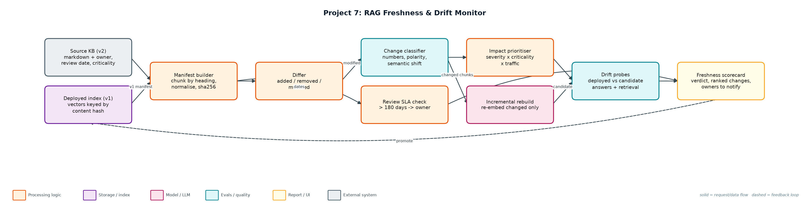
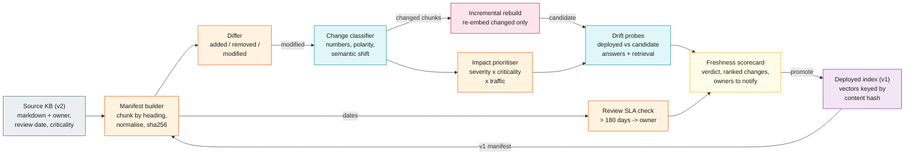

# Project 7: RAG Freshness & Drift Monitor

**Primary topic:** RAG · **Secondary:** Data quality, Observability, Incremental indexing

> Detects when the deployed RAG index has fallen behind its source documents, ranks changes by business impact, and proves an incremental rebuild fixes the stale answers.

## 1. Problem
RAG systems silently go stale. Prices change, policies flip, docs are deleted, and the vector index keeps serving last quarter's facts with full confidence. Teams only find out when a customer quotes the wrong refund window back to support.

### Why it matters
- Stale answers are confidently wrong, the worst failure mode for a support bot.
- Embedding similarity barely moves when '30 days' becomes '14 days'.
- Full re-indexing is slow and expensive; most chunks did not change.
- Doc owners need a review SLA, not just engineers.

## 2. Goals and success criteria
| Goal | Success criterion |
|---|---|
| Content manifest with hashes | Per-chunk sha256 of normalised text; whitespace-only edits ignored |
| Classify each change | cosmetic / minor / material using numbers, polarity words, semantic shift |
| Rank by impact | severity x criticality x probe traffic |
| Prove drift with probes | Deployed vs candidate answers; stale answers counted by traffic |
| Cheap incremental rebuild | Re-embed only material/minor/added chunks; report cost avoided |

### Non-goals
- Answer generation quality (see Project 1); answers are the best matching sentence.
- Crawling sources: KB folders stand in for Confluence/Notion/Git connectors.

## 3. Architecture




### Components
| Component | File | Responsibility |
|---|---|---|
| Manifest + classifier | freshness.py | Front-matter parsing, heading chunks, hashing, diff, change severity, review SLA. |
| Index + probes | drift.py | Hash-keyed vector index with embed-call counting; probe runner comparing deployed and candidate answers. |
| Monitor CLI | monitor.py | Builds both indexes, ranks changes, runs probes, prints and writes the scorecard. |
| Knowledge bases | data/kb_v1, data/kb_v2 | Five docs each: price changes, refund window, SCIM flip, typo fix, removed and added docs. |
| Probes | data/probes.jsonl | Ten production-style questions with the current fact and traffic weight. |

## 4. Request / data flow
1. Parse every source and deployed doc into heading-level chunks with owner, review date and criticality.
2. Hash normalised text: whitespace-only edits produce the same hash and are ignored.
3. Diff the manifests into added, removed and modified chunks.
4. Classify modified chunks: any numeric change or polarity flip (not/now/only/removed) is material, even if the embedding barely moved.
5. Rank changes by severity x doc criticality x how much probe traffic the chunk currently serves.
6. Build a candidate index by re-embedding only changed and added chunks; cosmetic edits update text but keep the vector.
7. Run probes against deployed and candidate; count stale answers weighted by traffic.
8. Write the scorecard with a verdict, ranked changes, probe table and owners past their review SLA.

## 5. Key design decisions
| Decision | Why | Trade-off |
|---|---|---|
| Rules before embeddings for change severity | Semantic shift for '30 -> 14 days' was only 0.041. | Rules need extending for new fact types (dates, names). |
| Traffic-weighted freshness | A stale pricing chunk matters more than a stale footnote. | Needs real query logs to estimate traffic. |
| Hash-keyed vectors | Makes incremental rebuild trivial and auditable. | Chunking changes invalidate all hashes. |
| Probes with current facts | Proves user-visible drift, not just file changes. | Probe set must be maintained (see Project 5). |
| Owner SLA in front-matter | Pushes freshness to the people who own the content. | Depends on accurate metadata. |

## 6. Evaluation and metrics
- 7 changes detected: 6 material, 1 cosmetic; the whitespace-only edit correctly produced no change.
- Embedding shift for numeric changes was 0.018-0.045, proving similarity alone would miss them.
- Traffic-weighted freshness 39% deployed -> 100% after incremental rebuild; 5 of 10 probes were stale and all fixed.
- Rebuild re-embedded 5 of 9 chunks (44% embedding cost avoided).
- 6 unit tests covering classification, hashing, diff, rebuild correctness, SLA and embed caching.

## 7. How to run
```bash
python monitor.py
python monitor.py --deployed data/kb_v1 --source data/kb_v2 --today 2026-11-06
python -m unittest discover -s tests
```

### Sample output
`python3 monitor.py`

```text
Deployed chunks: 9 · source chunks: 9
Changes: 7 (6 material, 0 minor, 1 cosmetic)

Prioritised changes:
  p= 26.1  modified material pricing#plans                      sem=0.018 traffic=190  numeric fact changed ['25 -> 29']
  p= 22.5  modified material refunds#refund-window              sem=0.041 traffic=150  numeric fact changed ['30 -> 14']
  p= 16.2  modified material pricing#annual-billing             sem=0.045 traffic=80   numeric fact changed ['15% -> 20%']
  p=  8.1  modified material sso#scim-provisioning              sem=0.521 traffic=35   polarity words changed: ['not', 'now']
  p=  6.0  added    material data-export#export-api             sem=1.0   traffic=0    new chunk not yet indexed
  p= 4.65  removed  material legacy-export#csv-export           sem=1.0   traffic=55   chunk deleted at source
  p=  0.0  modified cosmetic refunds#how-to-request             sem=0.043 traffic=40   typo / whitespace only

Probes (deployed -> candidate):
  p01 STALE -> fixed drift=answer           How much does the Pro plan cost per user?
  p02 STALE -> fixed drift=answer           What discount do I get for annual billing?
  p03 STALE -> fixed drift=answer           How many days do I have to get a refund on a monthly plan?
  p04 ok    -> ok    drift=answer           How long does it take for refunds to be processed?
  p05 STALE -> fixed drift=answer           Is SCIM user provisioning supported?
  p06 ok    -> ok    drift=-                Which plan includes SAML SSO?
  p07 ok    -> ok    drift=-                What is the API rate limit per minute?
  p08 ok    -> ok    drift=-                How many items does a list endpoint return per page?
  p09 STALE -> fixed drift=retrieval+answer How do I export my workspace data?
  p10 ok    -> ok    drift=-                How much does the Starter plan cost?

Traffic-weighted freshness: 39% deployed -> 100% after incremental rebuild
Incremental rebuild re-embedded 5 of 9 chunks (44% embedding cost avoided)
Docs past review SLA (180 days): sso (identity-team, 340d)
Verdict: REBUILD NOW
Wrote reports/freshness_scorecard.md and reports/source_manifest.json
```

## 8. Project structure
| Path | Purpose |
|---|---|
| freshness.py | Manifest, diff, change classification |
| drift.py | Vector index and drift probes |
| monitor.py | CLI and scorecard |
| data/ | kb_v1, kb_v2, probes |
| reports/ | freshness_scorecard.md, source_manifest.json |

## 9. Interview talking points
- Embeddings are bad at detecting factual change: 30 to 14 days moved similarity by only 4%.
- I combine cheap deterministic signals (hashes, numbers, polarity) with semantic shift.
- Freshness is traffic-weighted so the scorecard reflects user impact, not file counts.
- Incremental rebuild keyed by content hash avoided 44% of embedding calls here; far more at scale.
- Owners get notified when docs pass their review SLA, so freshness is a shared responsibility.

## 10. Production roadmap
- Connectors for Confluence, Notion, Google Drive and Git with webhooks for change events.
- Run on a schedule and on source webhooks; alert in Slack with the top 5 ranked changes.
- LLM-based fact extraction to compare claims between versions.
- Blue/green index promotion with probes as the gate.

## 11. Resume bullet
> Built a RAG freshness monitor that hashes and classifies source changes, ranks them by traffic impact and rebuilds incrementally, lifting traffic-weighted answer freshness from 39% to 100% while avoiding 44% of embedding cost.
