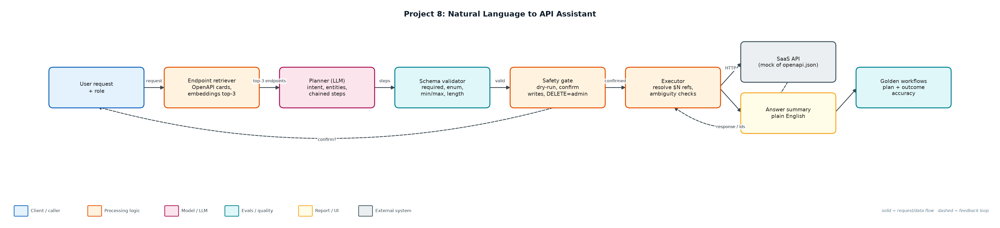

# Project 8: Natural Language to API Assistant

`Agents` `Tool calling` `OpenAPI` `Validation` `Human confirmation`

Turns requests like 'refund 200 EUR for Umbrella Health' into retrieved, planned, schema-validated and confirmed chains of real API calls.

## Goals
| Goal | Success criterion |
|---|---|
| Retrieve relevant endpoints | Top-3 endpoint cards from the OpenAPI spec; recall@3 = 14/14 |
| Plan chained calls | IDs flow between steps via $N references |
| Validate before calling | JSON-schema checks: required, enum, min/max, length |
| Safe execution | Dry-run; confirmation for writes; DELETE admin-only |
| Golden workflow suite | 16 workflows incl. ambiguity, not-found, invalid enum, API errors |

## Architecture

```mermaid
flowchart LR
    user["User request<br/>+ role"]:::client
    retriever["Endpoint retriever<br/>OpenAPI cards,<br/>embeddings top-3"]:::logic
    planner["Planner (LLM)<br/>intent, entities,<br/>chained steps"]:::llm
    validator["Schema validator<br/>required, enum,<br/>min/max, length"]:::eval
    gate["Safety gate<br/>dry-run, confirm<br/>writes, DELETE=admin"]:::logic
    executor["Executor<br/>resolve $N refs,<br/>ambiguity checks"]:::logic
    api["SaaS API<br/>(mock of openapi.json)"]:::external
    summary["Answer summary<br/>plain English"]:::ui
    suite["Golden workflows<br/>plan + outcome<br/>accuracy"]:::eval
    user -->|request| retriever
    retriever -->|top-3 endpoints| planner
    planner -->|steps| validator
    validator -->|valid| gate
    gate -->|confirmed| executor
    executor -->|HTTP| api
    executor --> summary
    api -->|response / ids| executor
    summary --> suite
    gate -->|confirm?| user
    classDef client fill:#E3F2FD,stroke:#1565C0,color:#1A1A1A
    classDef api fill:#E8F5E9,stroke:#2E7D32,color:#1A1A1A
    classDef logic fill:#FFF3E0,stroke:#E65100,color:#1A1A1A
    classDef store fill:#F3E5F5,stroke:#6A1B9A,color:#1A1A1A
    classDef llm fill:#FCE4EC,stroke:#AD1457,color:#1A1A1A
    classDef eval fill:#E0F7FA,stroke:#00838F,color:#1A1A1A
    classDef ui fill:#FFFDE7,stroke:#F9A825,color:#1A1A1A
    classDef external fill:#ECEFF1,stroke:#455A64,color:#1A1A1A
```


<details><summary>Mermaid source</summary>


</details>

## Quick start
No third-party packages needed (Python 3.10+).

```bash
python run_workflows.py
python run_workflows.py --ask "Show unpaid invoices for Globex"
python run_workflows.py --ask "Refund 200 EUR for Umbrella Health because of a duplicate charge" --dry-run
python -m unittest discover -s tests
```

## Sample output
```text
PASS w01 [done               ] Find the customer Globex                                       -> Globex Corporation (c_101, pro, active)
PASS w02 [done               ] Show unpaid invoices for Globex                                -> 1 invoice(s): inv_9002 1250.0 EUR unpaid
PASS w03 [done               ] What is the API usage for Umbrella Health this month?          -> 230,000 API requests, 31 seats, 64 GB
PASS w04 [done               ] Open an urgent priority ticket for Initech about overdue invoi -> ticket tk_1 (urgent) opened: overdue invoice reminder emails failing
PASS w05 [done               ] Refund 200 EUR for Umbrella Health because of a duplicate seat -> refund rf_1 of 200.0 EUR issued on inv_9004
PASS w06 [done               ] Give a full refund for Umbrella Health because the customer ch -> refund rf_1 of 640.0 EUR issued on inv_9004
PASS w07 [api_error          ] Refund 5000 EUR for Globex because of an outage                -> refund 5000.0 exceeds invoice amount 1250.0
PASS w08 [done               ] Upgrade Initech to the enterprise plan                         -> Initech is now on the enterprise plan
PASS w09 [validation_error   ] Move Globex to the platinum plan                               -> body.plan must be one of ['starter', 'pro', 'enterprise'] (got 'platin
PASS w10 [needs_clarification] Show invoices for Acme                                         -> did you mean Acme Ltd or Acme Labs?
PASS w11 [blocked            ] Delete customer Initech                                        -> deleteCustomer requires admin role (you are support)
PASS w12 [not_found          ] Show billing for Wayne Enterprises                             -> no customer matches 'Wayne Enterprises'
PASS w13 [validation_error   ] Open a high priority ticket for Globex about SSO               -> body.title shorter than 5 chars
PASS w14 [unsupported        ] What's the weather in Dublin?                                  -> unsupported request: no matching API capability
PASS w15 [cancelled          ] Downgrade Umbrella Health to the starter plan                  -> user declined PATCH /customers/c_105
PASS w16 [needs_clarification] Show overdue invoices                                          -> which customer do you mean?

Plan exact-match: 16/16 · outcome match: 16/16 · endpoint retrieval recall@3: 14/14
Write calls proposed: 7, executed: 5 (rest stopped by confirmation, role or validation)
```

## Files
| Path | Purpose |
|---|---|
| api/openapi.json | API contract |
| mock_api.py | Backend implementing the contract |
| assistant.py | Retrieval, planning, validation, execution |
| run_workflows.py | Golden suite and interactive CLI |
| data/workflows.jsonl | Golden workflows |

## Documentation
- [docs/PROJECT_EXPLANATION.md](docs/PROJECT_EXPLANATION.md) · [docs/PROJECT_EXPLANATION.docx](docs/PROJECT_EXPLANATION.docx): full explanation
- [docs/PRESENTATION.pptx](docs/PRESENTATION.pptx): slide deck for walkthroughs and interviews
