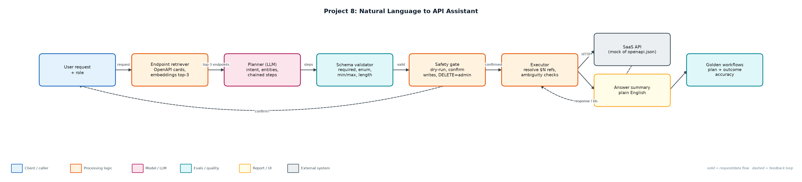

# Project 8: Natural Language to API Assistant

**Primary topic:** Agents · **Secondary:** Tool calling, OpenAPI, Validation, Human confirmation

> Turns requests like 'refund 200 EUR for Umbrella Health' into retrieved, planned, schema-validated and confirmed chains of real API calls.

## 1. Problem
Support and ops teams click through admin consoles to look up a customer, find the invoice and issue a refund. An LLM can do this from plain English, but only if it picks the right endpoint, fills valid parameters, chains IDs between calls, asks when the request is ambiguous and never mutates data without confirmation.

### Why it matters
- Most enterprise value sits behind internal APIs, not chat.
- Large OpenAPI specs do not fit in context: endpoint retrieval is required.
- Wrong-but-valid calls (refunding the wrong customer) are worse than errors.
- Writes need confirmation and role checks outside the model.

## 2. Goals and success criteria
| Goal | Success criterion |
|---|---|
| Retrieve relevant endpoints | Top-3 endpoint cards from the OpenAPI spec; recall@3 = 14/14 |
| Plan chained calls | IDs flow between steps via $N references |
| Validate before calling | JSON-schema checks: required, enum, min/max, length |
| Safe execution | Dry-run; confirmation for writes; DELETE admin-only |
| Golden workflow suite | 16 workflows incl. ambiguity, not-found, invalid enum, API errors |

### Non-goals
- A production LLM planner: a deterministic planner stands in so the suite is reproducible.
- Auth/OAuth to real SaaS APIs; a mock backend implements the spec.

## 3. Architecture

```mermaid
flowchart LR
    user["User request<br/>+ role"]:::client
    retriever["Endpoint retriever<br/>OpenAPI cards,<br/>embeddings top-3"]:::logic
    planner["Planner (LLM)<br/>intent, entities,<br/>chained steps"]:::llm
    validator["Schema validator<br/>required, enum,<br/>min/max, length"]:::eval
    gate["Safety gate<br/>dry-run, confirm<br/>writes, DELETE=admin"]:::logic
    executor["Executor<br/>resolve $N refs,<br/>ambiguity checks"]:::logic
    api["SaaS API<br/>(mock of openapi.json)"]:::external
    summary["Answer summary<br/>plain English"]:::ui
    suite["Golden workflows<br/>plan + outcome<br/>accuracy"]:::eval
    user -->|request| retriever
    retriever -->|top-3 endpoints| planner
    planner -->|steps| validator
    validator -->|valid| gate
    gate -->|confirmed| executor
    executor -->|HTTP| api
    executor --> summary
    api -->|response / ids| executor
    summary --> suite
    gate -->|confirm?| user
    classDef client fill:#E3F2FD,stroke:#1565C0,color:#1A1A1A
    classDef api fill:#E8F5E9,stroke:#2E7D32,color:#1A1A1A
    classDef logic fill:#FFF3E0,stroke:#E65100,color:#1A1A1A
    classDef store fill:#F3E5F5,stroke:#6A1B9A,color:#1A1A1A
    classDef llm fill:#FCE4EC,stroke:#AD1457,color:#1A1A1A
    classDef eval fill:#E0F7FA,stroke:#00838F,color:#1A1A1A
    classDef ui fill:#FFFDE7,stroke:#F9A825,color:#1A1A1A
    classDef external fill:#ECEFF1,stroke:#455A64,color:#1A1A1A
```




### Components
| Component | File | Responsibility |
|---|---|---|
| OpenAPI spec | api/openapi.json | 7 operations: customers, invoices, refunds, tickets, usage, plan change, delete. |
| Mock backend | mock_api.py | In-memory implementation with business errors (refund > invoice, unpaid refunds). |
| Assistant | assistant.py | Endpoint index, JSON-schema validator, planner, $N reference resolution, safety gate, summaries. |
| Workflow suite + CLI | run_workflows.py | Runs the golden suite or a single --ask request, with --dry-run. |
| Golden workflows | data/workflows.jsonl | 16 requests with expected call sequence and outcome. |

## 4. Request / data flow
1. Embed every operation as a card (id, method, path, summary, description) and retrieve the top 3 for the request.
2. The planner extracts intent and entities (customer, amount, priority, plan) and emits a chain of steps; the primary endpoint must be in the retrieved set.
3. Each step's arguments may reference earlier results, e.g. $0.items.0.id for the customer found in step 0.
4. Before each call, arguments are validated against the parameter and body schemas.
5. Customer lookups must resolve to exactly one record; zero means not_found, several means ask the user which one.
6. Writes ask for confirmation; DELETE requires the admin role; dry-run shows the planned HTTP calls without executing.
7. Responses are summarised in plain English; API business errors are surfaced, not retried blindly.

## 5. Key design decisions
| Decision | Why | Trade-off |
|---|---|---|
| Retrieve endpoints instead of stuffing the spec | Scales to hundreds of operations and reduces wrong picks. | Retrieval misses become planning failures. |
| Explicit $N references | Makes chains inspectable and dry-runnable. | Planner must emit structured references. |
| Ask on ambiguity | Refunding the wrong 'Acme' is worse than a question. | One more turn for the user. |
| Validate client-side first | Cheaper and clearer errors than the API's 400s. | Schema and server may diverge; keep both. |
| Confirmation outside the model | The model cannot skip it. | Friction for low-risk writes; tune per endpoint. |

## 6. Evaluation and metrics
- 16/16 golden workflows: plan exact-match and outcome match.
- Endpoint retrieval recall@3: 14/14 for requests that need an endpoint.
- 7 write calls proposed, 5 executed; the rest were stopped by confirmation or the admin-only rule.
- Covers ambiguity (Acme Ltd vs Acme Labs), not-found, invalid enum, short title, refund over invoice amount and unsupported requests.
- 6 unit tests for validation, chaining, confirmation, role block, ambiguity and dry-run.

## 7. How to run
```bash
python run_workflows.py
python run_workflows.py --ask "Show unpaid invoices for Globex"
python run_workflows.py --ask "Refund 200 EUR for Umbrella Health because of a duplicate charge" --dry-run
python -m unittest discover -s tests
```

### Sample output
`python3 run_workflows.py`

```text
PASS w01 [done               ] Find the customer Globex                                       -> Globex Corporation (c_101, pro, active)
PASS w02 [done               ] Show unpaid invoices for Globex                                -> 1 invoice(s): inv_9002 1250.0 EUR unpaid
PASS w03 [done               ] What is the API usage for Umbrella Health this month?          -> 230,000 API requests, 31 seats, 64 GB
PASS w04 [done               ] Open an urgent priority ticket for Initech about overdue invoi -> ticket tk_1 (urgent) opened: overdue invoice reminder emails failing
PASS w05 [done               ] Refund 200 EUR for Umbrella Health because of a duplicate seat -> refund rf_1 of 200.0 EUR issued on inv_9004
PASS w06 [done               ] Give a full refund for Umbrella Health because the customer ch -> refund rf_1 of 640.0 EUR issued on inv_9004
PASS w07 [api_error          ] Refund 5000 EUR for Globex because of an outage                -> refund 5000.0 exceeds invoice amount 1250.0
PASS w08 [done               ] Upgrade Initech to the enterprise plan                         -> Initech is now on the enterprise plan
PASS w09 [validation_error   ] Move Globex to the platinum plan                               -> body.plan must be one of ['starter', 'pro', 'enterprise'] (got 'platin
PASS w10 [needs_clarification] Show invoices for Acme                                         -> did you mean Acme Ltd or Acme Labs?
PASS w11 [blocked            ] Delete customer Initech                                        -> deleteCustomer requires admin role (you are support)
PASS w12 [not_found          ] Show billing for Wayne Enterprises                             -> no customer matches 'Wayne Enterprises'
PASS w13 [validation_error   ] Open a high priority ticket for Globex about SSO               -> body.title shorter than 5 chars
PASS w14 [unsupported        ] What's the weather in Dublin?                                  -> unsupported request: no matching API capability
PASS w15 [cancelled          ] Downgrade Umbrella Health to the starter plan                  -> user declined PATCH /customers/c_105
PASS w16 [needs_clarification] Show overdue invoices                                          -> which customer do you mean?

Plan exact-match: 16/16 · outcome match: 16/16 · endpoint retrieval recall@3: 14/14
Write calls proposed: 7, executed: 5 (rest stopped by confirmation, role or validation)
```

## 8. Project structure
| Path | Purpose |
|---|---|
| api/openapi.json | API contract |
| mock_api.py | Backend implementing the contract |
| assistant.py | Retrieval, planning, validation, execution |
| run_workflows.py | Golden suite and interactive CLI |
| data/workflows.jsonl | Golden workflows |

## 9. Interview talking points
- The OpenAPI spec is the single source of truth: retrieval cards, validation schemas and the mock all come from it.
- I retrieve endpoints rather than putting the whole spec in context; recall@3 is tracked as a metric.
- Chained calls use explicit references so a dry-run shows exactly what will happen.
- Ambiguity is a first-class outcome: the assistant asks instead of guessing.
- Every write passes a confirmation and role gate that lives in code, not in the prompt.

## 10. Production roadmap
- Use OpenAI/Anthropic structured tool calls generated from the OpenAPI schemas.
- OAuth on behalf of the user so API permissions match the human's.
- Idempotency keys for writes and an audit log of every executed call.
- Grow the golden suite from production requests (Project 5).

## 11. Resume bullet
> Built an NL-to-API assistant that retrieves OpenAPI endpoints, plans chained calls, validates against JSON schema and gates writes behind confirmation and roles, passing 16/16 golden workflows including ambiguity and error cases.
