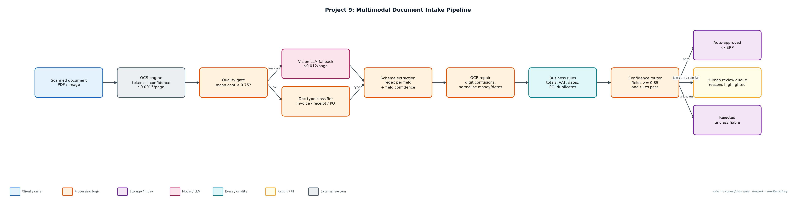

# Project 9: Multimodal Document Intake Pipeline

`Multimodal` `OCR` `Structured extraction` `Business rules` `Human review`

Reads scanned invoices, receipts and purchase orders, falls back to a vision model only when OCR is unreliable, validates against business rules and routes by field confidence.

## Goals
| Goal | Success criterion |
|---|---|
| OCR quality gate | Mean token confidence < 0.75 triggers vision fallback |
| Typed extraction per document type | Invoice (10 fields), receipt (4), PO (4) with normalisation |
| Repair OCR confusions | O->0, l->1, S->5, B->8 in numeric fields, logged |
| Business rules | Totals add up, VAT 23%, dates, VAT-id format, PO in ERP, duplicates |
| Zero-escape routing | Auto-approve only if all fields >= 0.85 and rules pass |

## Architecture

```mermaid
flowchart LR
    upload["Scanned document<br/>PDF / image"]:::client
    ocr["OCR engine<br/>tokens + confidence<br/>$0.0015/page"]:::external
    quality["Quality gate<br/>mean conf < 0.75?"]:::logic
    vision["Vision LLM fallback<br/>$0.012/page"]:::llm
    classify["Doc-type classifier<br/>invoice / receipt / PO"]:::logic
    extract["Schema extraction<br/>regex per field<br/>+ field confidence"]:::logic
    repair["OCR repair<br/>digit confusions,<br/>normalise money/dates"]:::logic
    rules["Business rules<br/>totals, VAT, dates,<br/>PO, duplicates"]:::eval
    router["Confidence router<br/>fields >= 0.85<br/>and rules pass"]:::logic
    approved["Auto-approved<br/>-> ERP"]:::store
    review["Human review queue<br/>reasons highlighted"]:::ui
    reject["Rejected<br/>unclassifiable"]:::store
    upload --> ocr
    ocr --> quality
    quality -->|low conf| vision
    quality -->|ok| classify
    vision --> extract
    classify -->|type| extract
    extract --> repair
    repair --> rules
    rules --> router
    router -->|pass| approved
    router -->|low conf / rule fail| review
    router -->|unknown| reject
    classDef client fill:#E3F2FD,stroke:#1565C0,color:#1A1A1A
    classDef api fill:#E8F5E9,stroke:#2E7D32,color:#1A1A1A
    classDef logic fill:#FFF3E0,stroke:#E65100,color:#1A1A1A
    classDef store fill:#F3E5F5,stroke:#6A1B9A,color:#1A1A1A
    classDef llm fill:#FCE4EC,stroke:#AD1457,color:#1A1A1A
    classDef eval fill:#E0F7FA,stroke:#00838F,color:#1A1A1A
    classDef ui fill:#FFFDE7,stroke:#F9A825,color:#1A1A1A
    classDef external fill:#ECEFF1,stroke:#455A64,color:#1A1A1A
```


<details><summary>Mermaid source</summary>


</details>

## Quick start
No third-party packages needed (Python 3.10+).

```bash
python generate_docs.py --n 80
python run_intake.py
python -m unittest discover -s tests
```

## Sample output
```text
Documents: 80 · type accuracy 100% · field accuracy 98.9% (614 fields)
Routing: {'human_review': 18, 'auto_approve': 62} · straight-through rate 78%
Auto-approved with an error (escapes): 0 []
Business-rule issues caught: 3/3
Vision fallback: 10 docs · total cost $0.2400 ($0.00300/doc vs $0.0135/doc if every page used vision)
OCR corrections applied: 8

Route by scenario:
  bad_scan           {'auto_approve': 10}
  business_error     {'human_review': 3}
  clean              {'auto_approve': 50}
  handwritten_total  {'human_review': 7}
  ocr_noise          {'human_review': 8, 'auto_approve': 2}

Sample review items:
  doc-000 (ocr_noise): low confidence: total
  doc-001 (handwritten_total): low confidence: total
  doc-002 (business_error): subtotal + VAT (1273.05) != total (1283.05)
  doc-012 (handwritten_total): subtotal + VAT (4102.05) != total (4102.06)
  doc-027 (ocr_noise): low confidence: total

Field accuracy:
  total           73/80
  supplier        63/63
  invoice_number  49/49
  invoice_date    49/49
  due_date        49/49
  vat_id          49/49
  po_number       63/63
  buyer           49/49
  subtotal        49/49
  vat             49/49
  order_date      14/14
  merchant        17/17
  date            17/17
  card_last4      17/17
```

## Files
| Path | Purpose |
|---|---|
| generate_docs.py | Synthetic scanned documents with ground truth |
| intake.py | Pipeline stages |
| run_intake.py | Runner and evaluation |
| data/documents.jsonl | OCR token streams + truth |
| outputs/ | approved, review_queue, rejected |

## Documentation
- [docs/PROJECT_EXPLANATION.md](docs/PROJECT_EXPLANATION.md) · [docs/PROJECT_EXPLANATION.docx](docs/PROJECT_EXPLANATION.docx): full explanation
- [docs/PRESENTATION.pptx](docs/PRESENTATION.pptx): slide deck for walkthroughs and interviews
