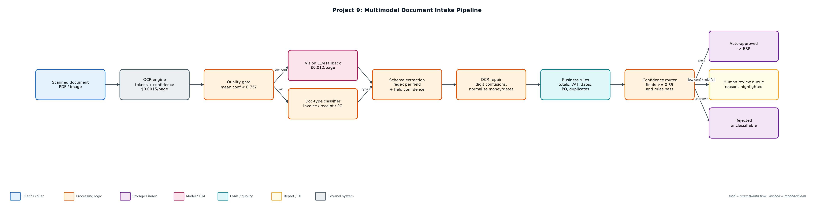

# Project 9: Multimodal Document Intake Pipeline

**Primary topic:** Multimodal · **Secondary:** OCR, Structured extraction, Business rules, Human review

> Reads scanned invoices, receipts and purchase orders, falls back to a vision model only when OCR is unreliable, validates against business rules and routes by field confidence.

## 1. Problem
Finance and ops teams still key in invoices by hand. Sending every page to a vision LLM is accurate but expensive and still makes silent mistakes on handwritten totals. The goal is high straight-through processing with zero wrong values auto-approved.

### Why it matters
- Document intake is one of the highest-ROI enterprise AI use cases.
- Extraction errors in money fields are costly and hard to spot later.
- Vision models cost ~8x OCR here; use them only where they add accuracy.
- Auditors need to see why each document was approved or held.

## 2. Goals and success criteria
| Goal | Success criterion |
|---|---|
| OCR quality gate | Mean token confidence < 0.75 triggers vision fallback |
| Typed extraction per document type | Invoice (10 fields), receipt (4), PO (4) with normalisation |
| Repair OCR confusions | O->0, l->1, S->5, B->8 in numeric fields, logged |
| Business rules | Totals add up, VAT 23%, dates, VAT-id format, PO in ERP, duplicates |
| Zero-escape routing | Auto-approve only if all fields >= 0.85 and rules pass |

### Non-goals
- Real OCR/vision inference: token streams with confidence are simulated; Tesseract/Textract/GPT-4o plug in at the same interface.
- Line-item table extraction.

## 3. Architecture

```mermaid
flowchart LR
    upload["Scanned document<br/>PDF / image"]:::client
    ocr["OCR engine<br/>tokens + confidence<br/>$0.0015/page"]:::external
    quality["Quality gate<br/>mean conf < 0.75?"]:::logic
    vision["Vision LLM fallback<br/>$0.012/page"]:::llm
    classify["Doc-type classifier<br/>invoice / receipt / PO"]:::logic
    extract["Schema extraction<br/>regex per field<br/>+ field confidence"]:::logic
    repair["OCR repair<br/>digit confusions,<br/>normalise money/dates"]:::logic
    rules["Business rules<br/>totals, VAT, dates,<br/>PO, duplicates"]:::eval
    router["Confidence router<br/>fields >= 0.85<br/>and rules pass"]:::logic
    approved["Auto-approved<br/>-> ERP"]:::store
    review["Human review queue<br/>reasons highlighted"]:::ui
    reject["Rejected<br/>unclassifiable"]:::store
    upload --> ocr
    ocr --> quality
    quality -->|low conf| vision
    quality -->|ok| classify
    vision --> extract
    classify -->|type| extract
    extract --> repair
    repair --> rules
    rules --> router
    router -->|pass| approved
    router -->|low conf / rule fail| review
    router -->|unknown| reject
    classDef client fill:#E3F2FD,stroke:#1565C0,color:#1A1A1A
    classDef api fill:#E8F5E9,stroke:#2E7D32,color:#1A1A1A
    classDef logic fill:#FFF3E0,stroke:#E65100,color:#1A1A1A
    classDef store fill:#F3E5F5,stroke:#6A1B9A,color:#1A1A1A
    classDef llm fill:#FCE4EC,stroke:#AD1457,color:#1A1A1A
    classDef eval fill:#E0F7FA,stroke:#00838F,color:#1A1A1A
    classDef ui fill:#FFFDE7,stroke:#F9A825,color:#1A1A1A
    classDef external fill:#ECEFF1,stroke:#455A64,color:#1A1A1A
```




### Components
| Component | File | Responsibility |
|---|---|---|
| Document generator | generate_docs.py | 80 seeded documents across 5 scenarios: clean, OCR noise, handwritten total, bad scan, business error. |
| Intake pipeline | intake.py | Quality gate, vision fallback, classifier, schemas, normalisation, business rules, routing. |
| Runner + evaluation | run_intake.py | Processes all docs, scores against ground truth, writes approved/review/rejected JSONL. |
| Outputs | outputs/*.jsonl | Approved extractions, review queue with reasons, rejections. |

## 4. Request / data flow
1. OCR returns tokens with confidence for every line of the page.
2. If mean confidence is below 0.75, the page is re-read by the vision model (8x cost).
3. The document type is classified by keyword evidence; unknown documents are rejected.
4. Fields are extracted with a schema per type; each field's confidence is the minimum of its tokens.
5. Numeric fields are repaired for OCR digit confusions and normalised (money, ISO dates, ids).
6. Business rules check arithmetic, VAT rate, date order, VAT-id format, PO existence and duplicate invoice numbers.
7. Documents with any low-confidence field or rule failure go to human review with the reasons; the rest are auto-approved.

## 5. Key design decisions
| Decision | Why | Trade-off |
|---|---|---|
| Vision only as fallback | Bad scans are ~10% of volume; cost/doc stays at $0.003. | A second model to monitor. |
| Min-token confidence per field | One bad digit should hold the whole amount. | More conservative routing. |
| Rules are the safety net | Handwritten totals passed OCR but failed arithmetic. | Rules must be written per document type. |
| Log every repair | Reviewers and auditors see what was changed. | Noisier logs. |
| Optimise for zero escapes, then STP | Wrong auto-approved money is the costly error. | Lower straight-through rate. |

## 6. Evaluation and metrics
- 80 documents: 100% type accuracy, 98.9% field accuracy over 614 fields.
- 78% straight-through processing, 0 auto-approved documents with any wrong field.
- All 3 business-rule issues (duplicate invoice, totals mismatch) caught; all 7 handwritten totals held for review.
- Vision fallback used on the 10 bad scans only: $0.0030/doc vs $0.0135/doc if every page used vision.
- 6 unit tests for repair, classification, clean path, fallback, handwritten totals and duplicates.

## 7. How to run
```bash
python generate_docs.py --n 80
python run_intake.py
python -m unittest discover -s tests
```

### Sample output
`python3 run_intake.py`

```text
Documents: 80 · type accuracy 100% · field accuracy 98.9% (614 fields)
Routing: {'human_review': 18, 'auto_approve': 62} · straight-through rate 78%
Auto-approved with an error (escapes): 0 []
Business-rule issues caught: 3/3
Vision fallback: 10 docs · total cost $0.2400 ($0.00300/doc vs $0.0135/doc if every page used vision)
OCR corrections applied: 8

Route by scenario:
  bad_scan           {'auto_approve': 10}
  business_error     {'human_review': 3}
  clean              {'auto_approve': 50}
  handwritten_total  {'human_review': 7}
  ocr_noise          {'human_review': 8, 'auto_approve': 2}

Sample review items:
  doc-000 (ocr_noise): low confidence: total
  doc-001 (handwritten_total): low confidence: total
  doc-002 (business_error): subtotal + VAT (1273.05) != total (1283.05)
  doc-012 (handwritten_total): subtotal + VAT (4102.05) != total (4102.06)
  doc-027 (ocr_noise): low confidence: total

Field accuracy:
  total           73/80
  supplier        63/63
  invoice_number  49/49
  invoice_date    49/49
  due_date        49/49
  vat_id          49/49
  po_number       63/63
  buyer           49/49
  subtotal        49/49
  vat             49/49
  order_date      14/14
  merchant        17/17
  date            17/17
  card_last4      17/17
```

## 8. Project structure
| Path | Purpose |
|---|---|
| generate_docs.py | Synthetic scanned documents with ground truth |
| intake.py | Pipeline stages |
| run_intake.py | Runner and evaluation |
| data/documents.jsonl | OCR token streams + truth |
| outputs/ | approved, review_queue, rejected |

## 9. Interview talking points
- Confidence routing is the product: 78% straight-through with zero wrong values auto-approved.
- OCR first, vision as fallback: 4.5x cheaper than sending every page to a multimodal model.
- Business rules caught what confidence could not: a handwritten total off by one cent.
- Every OCR repair is logged so a reviewer can see '2O5' became '205'.
- The same interface accepts Textract, Azure Document Intelligence or GPT-4o vision.

## 10. Production roadmap
- Plug in Tesseract/Textract for OCR and GPT-4o/Claude vision with structured output for fallback.
- Streamlit review UI showing the page image with low-confidence fields highlighted.
- Feed reviewer corrections back as few-shot examples and to tune thresholds per field.
- ERP integration for PO matching and payment scheduling.

## 11. Resume bullet
> Built a document intake pipeline with OCR quality gating, vision-LLM fallback, OCR repair and business-rule validation, reaching 78% straight-through processing with zero erroneous auto-approvals at $0.003/document.
