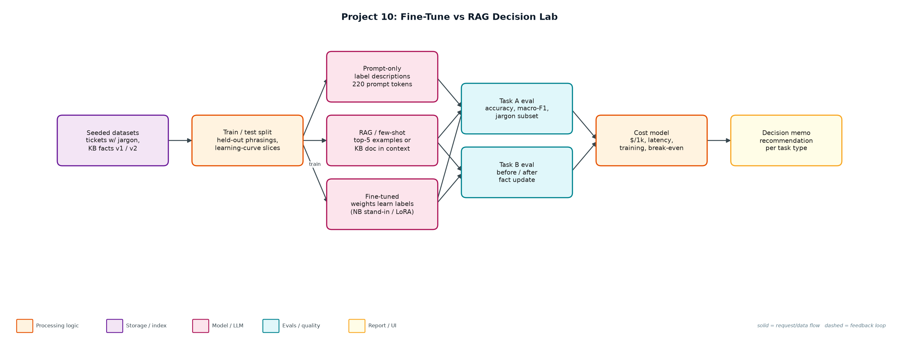
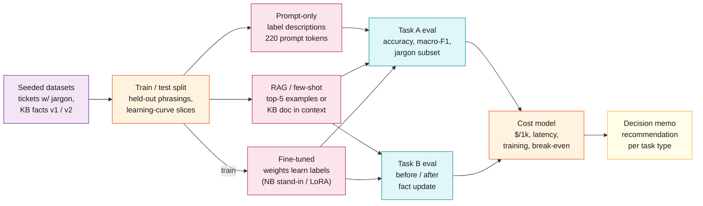

# Project 10: Fine-Tune vs RAG Decision Lab

`Fine-tuning` `RAG` `Cost modelling` `Experiment design`

A reproducible lab that answers 'should we fine-tune or use RAG?' with numbers: accuracy, jargon handling, data needed, cost per request, break-even and behaviour after facts change.

## Goals
| Goal | Success criterion |
|---|---|
| Same task, three approaches | Prompt-only vs RAG few-shot vs trained weights |
| Honest generalisation | One phrasing per queue held out of training |
| Measure data needs | Learning curve at 25/50/100/200/400 examples |
| Cost model | $/1k requests, latency, training cost and break-even volume |
| Knowledge freshness test | Accuracy after 4 of 10 facts change, without retraining |

## Architecture


<details><summary>Mermaid source</summary>


</details>

## Quick start
No third-party packages needed (Python 3.10+).

```bash
python lab.py
python lora_train.py --model Qwen/Qwen2.5-0.5B-Instruct   # optional, needs transformers + peft
python -m unittest discover -s tests
```

## Sample output
```text
Task A - ticket routing with company jargon (300 test tickets, 79 with jargon)
  approach          acc  macroF1  jargon  prompt tok  $/1k req  latency
  prompt_only     83.3%    0.830   53.2%         220    0.0384     410ms
  rag_few_shot    92.7%    0.925   83.5%         420    0.0684     420ms
  fine_tuned      95.3%    0.951   88.6%          40    0.0228     401ms
  fine-tune training cost: $0.0586 (400 examples x 3 epochs)
  learning curve (accuracy by # labelled examples):
    n=25   rag=44.3%  fine_tuned=52.0%
    n=50   rag=62.3%  fine_tuned=74.0%
    n=100  rag=78.3%  fine_tuned=88.0%
    n=200  rag=87.0%  fine_tuned=94.3%
    n=400  rag=92.7%  fine_tuned=95.3%
  fine-tune pays back its training cost after ~1,285 requests vs RAG few-shot

Task B - product facts, 4 of 10 facts change after training
  approach        before  after update  changed facts
  prompt_only         0%            0%             0%
  rag               100%          100%           100%
  fine_tuned         97%           57%             0%
  update cost: RAG = re-embed 4 docs (seconds, ~$0.0001); fine-tune = new training run + eval + deploy (hours)

Decision: Task A -> fine tuned (learns jargon, shortest prompt); Task B -> RAG (facts change; fine-tune was 0% on changed facts).
Hybrid recommendation: fine-tune for routing/format/tone, RAG for anything factual or fast-changing.
Wrote reports/decision_memo.md and reports/results.json
```

## Files
| Path | Purpose |
|---|---|
| make_data.py | Seeded datasets |
| approaches.py | Prompt-only, RAG, fine-tune stand-ins |
| lab.py | Experiments, cost model, decision memo |
| lora_train.py | Optional real LoRA |
| reports/ | Decision memo and raw results |

## Documentation
- [docs/PROJECT_EXPLANATION.md](docs/PROJECT_EXPLANATION.md) · [docs/PROJECT_EXPLANATION.docx](docs/PROJECT_EXPLANATION.docx): full explanation
- [docs/PRESENTATION.pptx](docs/PRESENTATION.pptx): slide deck for walkthroughs and interviews
