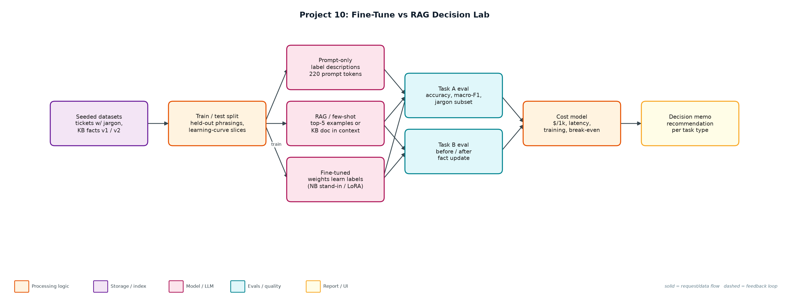
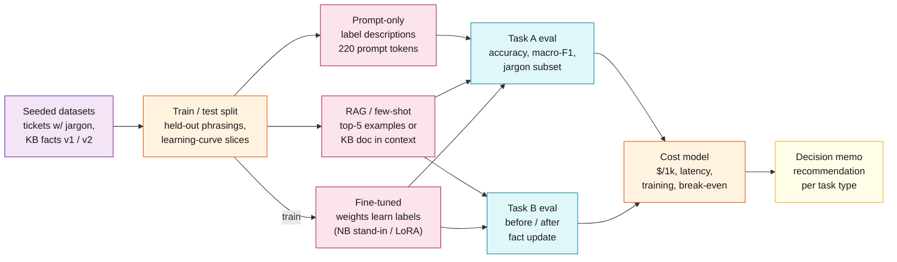

# Project 10: Fine-Tune vs RAG Decision Lab

**Primary topic:** Fine-tuning · **Secondary:** RAG, Cost modelling, Experiment design

> A reproducible lab that answers 'should we fine-tune or use RAG?' with numbers: accuracy, jargon handling, data needed, cost per request, break-even and behaviour after facts change.

## 1. Problem
Teams argue about fine-tuning vs RAG from blog posts. The real answer depends on whether the task is about behaviour (labels, format, jargon) or knowledge (facts that change), how much labelled data exists, and request volume. This lab measures all of that on the same data.

### Why it matters
- Fine-tuning for facts creates silently stale models.
- RAG for behaviour wastes tokens on every request.
- Data availability decides more than model choice: prompt-only wins with few labels.
- Leaders need a decision memo, not a vibe.

## 2. Goals and success criteria
| Goal | Success criterion |
|---|---|
| Same task, three approaches | Prompt-only vs RAG few-shot vs trained weights |
| Honest generalisation | One phrasing per queue held out of training |
| Measure data needs | Learning curve at 25/50/100/200/400 examples |
| Cost model | $/1k requests, latency, training cost and break-even volume |
| Knowledge freshness test | Accuracy after 4 of 10 facts change, without retraining |

### Non-goals
- State-of-the-art accuracy: naive Bayes stands in for LoRA so the lab runs anywhere in seconds.
- lora_train.py provides a real PEFT run when a GPU and transformers are available.

## 3. Architecture




### Components
| Component | File | Responsibility |
|---|---|---|
| Datasets | make_data.py | 8-queue tickets with company jargon (Nimbus, Gatekeeper, Ledger) and 10 product facts, 4 changed in v2. |
| Approaches | approaches.py | PromptOnly, RetrievalFewShot (kNN over embeddings), FineTuned (naive Bayes, word+bigram) and knowledge variants. |
| Lab runner | lab.py | Both tasks, learning curve, cost model, break-even, decision memo. |
| Real LoRA (optional) | lora_train.py | PEFT LoRA on Qwen2.5-0.5B with the same prompts and test set. |
| Reports | reports/ | decision_memo.md and results.json. |

## 4. Request / data flow
1. Generate tickets: train uses 5 of 6 phrasings per queue; test includes the held-out phrasing and no label noise.
2. Prompt-only sees label descriptions with generic keywords and no examples.
3. RAG few-shot embeds the training tickets and puts the top 5 neighbours in the prompt.
4. The fine-tune stand-in learns the label conventions into weights and needs only a short prompt.
5. Score accuracy, macro-F1 and accuracy on tickets that contain company jargon; repeat at 25-400 training examples.
6. Estimate $/1k requests from prompt size (fine-tuned inference priced at 2x base) and the one-off training cost.
7. Task B: train the knowledge fine-tune on v1 facts, update 4 facts, and compare with RAG over the updated KB.
8. Write the decision memo with a recommendation for each task type.

## 5. Key design decisions
| Decision | Why | Trade-off |
|---|---|---|
| Two tasks, not one | Behaviour and knowledge reward different approaches. | More to explain. |
| Hold out phrasings | Shared templates gave a misleading 100%. | Lower, more honest numbers. |
| Stand-in model by default | Runs in seconds on any laptop; deterministic. | Absolute accuracy differs from a real LoRA. |
| Price fine-tuned inference at 2x | Matches hosted fine-tune pricing patterns. | Self-hosting changes the maths. |
| Report break-even volume | Turns the debate into a threshold. | Ignores engineering time and eval upkeep. |

## 6. Evaluation and metrics
- Task A (300 test tickets): prompt-only 83.3%, RAG few-shot 92.7%, fine-tuned 95.3%; on jargon tickets 53% / 84% / 89%.
- Fine-tuned uses 40 prompt tokens vs 420 for few-shot: $0.023 vs $0.068 per 1k requests; training cost $0.06 pays back after ~1.3k requests.
- Learning curve: with 25 labels, prompt-only (83%) beats both RAG (44%) and fine-tune (52%).
- Task B: after 4 facts change, RAG stays at 100%; the fine-tune drops to 57% overall and 0% on changed facts.
- 4 unit tests for holdout, jargon learning, fact freshness and macro-F1.

## 7. How to run
```bash
python lab.py
python lora_train.py --model Qwen/Qwen2.5-0.5B-Instruct   # optional, needs transformers + peft
python -m unittest discover -s tests
```

### Sample output
`python3 lab.py`

```text
Task A - ticket routing with company jargon (300 test tickets, 79 with jargon)
  approach          acc  macroF1  jargon  prompt tok  $/1k req  latency
  prompt_only     83.3%    0.830   53.2%         220    0.0384     410ms
  rag_few_shot    92.7%    0.925   83.5%         420    0.0684     420ms
  fine_tuned      95.3%    0.951   88.6%          40    0.0228     401ms
  fine-tune training cost: $0.0586 (400 examples x 3 epochs)
  learning curve (accuracy by # labelled examples):
    n=25   rag=44.3%  fine_tuned=52.0%
    n=50   rag=62.3%  fine_tuned=74.0%
    n=100  rag=78.3%  fine_tuned=88.0%
    n=200  rag=87.0%  fine_tuned=94.3%
    n=400  rag=92.7%  fine_tuned=95.3%
  fine-tune pays back its training cost after ~1,285 requests vs RAG few-shot

Task B - product facts, 4 of 10 facts change after training
  approach        before  after update  changed facts
  prompt_only         0%            0%             0%
  rag               100%          100%           100%
  fine_tuned         97%           57%             0%
  update cost: RAG = re-embed 4 docs (seconds, ~$0.0001); fine-tune = new training run + eval + deploy (hours)

Decision: Task A -> fine tuned (learns jargon, shortest prompt); Task B -> RAG (facts change; fine-tune was 0% on changed facts).
Hybrid recommendation: fine-tune for routing/format/tone, RAG for anything factual or fast-changing.
Wrote reports/decision_memo.md and reports/results.json
```

## 8. Project structure
| Path | Purpose |
|---|---|
| make_data.py | Seeded datasets |
| approaches.py | Prompt-only, RAG, fine-tune stand-ins |
| lab.py | Experiments, cost model, decision memo |
| lora_train.py | Optional real LoRA |
| reports/ | Decision memo and raw results |

## 9. Interview talking points
- Fine-tune for behaviour, RAG for knowledge: the lab shows both halves with numbers.
- The fine-tune scored 0% on facts that changed after training; RAG fixed them by re-embedding 4 docs.
- With fewer than ~100 labels, prompt-only beats both; data, not model choice, is the constraint.
- Fine-tuning cut prompt tokens 10x and cost 3x; the training cost paid back after ~1.3k requests.
- I held out phrasings after spotting a misleading 100%; evaluation design is the real skill here.

## 10. Production roadmap
- Run lora_train.py and hosted fine-tunes (OpenAI, Bedrock) on the same split; add to the results table.
- Use real tickets from Project 5's eval set instead of templates.
- Hybrid: fine-tuned router + RAG answerer, evaluated end to end.
- Track drift: alert when fine-tune accuracy on fresh labels drops below RAG.

## 11. Resume bullet
> Built a fine-tune vs RAG decision lab measuring accuracy, data needs, cost and fact freshness; showed the fine-tune won on routing (95.3% at 3x lower cost) but fell to 0% on changed facts, which RAG kept at 100%.
