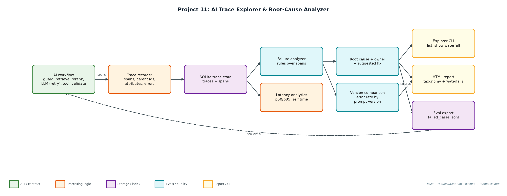
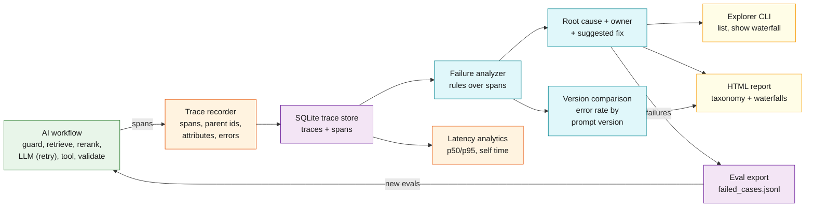

# Project 11: AI Trace Explorer & Root-Cause Analyzer

`Observability` `Tracing` `Debugging` `Regression detection` `Evals`

Traces every step of an AI workflow, classifies what went wrong, points at the span that caused it, and turns failures into eval cases.

## Goals
| Goal | Success criterion |
|---|---|
| Step-level tracing | OpenTelemetry-shaped spans with parent ids and attributes in SQLite |
| Failure taxonomy | 9 categories with owner and suggested fix |
| Root cause per trace | Highest-severity, earliest finding; 100% vs injected faults |
| Regression detection | Error rate and categories by prompt version |
| Close the loop | Failing traces exported as draft eval cases |

## Architecture


<details><summary>Mermaid source</summary>


</details>

## Quick start
No third-party packages needed (Python 3.10+).

```bash
python explorer.py demo
python explorer.py simulate --n 300 && python explorer.py summary
python explorer.py list --category schema_invalid
python explorer.py show <trace_id>
python -m unittest discover -s tests
```

## Sample output
```text
Simulated 300 traces; injected faults: {'none': 176, 'schema_invalid': 38, 'retrieval_empty': 19, 'ungrounded': 17, 'rate_limited': 14, 'tool_error': 11, 'slow_rerank': 10, 'llm_timeout': 10, 'context_overflow': 5}

Traces: 300 · hard failures: 54 (18%) · traces with any finding: 111

Root-cause taxonomy (owner -> suggested fix):
   38  schema_invalid           [prompt] Output was not valid JSON: use structured output / JSON mode; compare prompt versions.
   19  retrieval_empty          [rag] No documents retrieved: check query rewriting and index freshness before blaming the model.
   17  ungrounded               [quality] Answer has low grounding and no citations: enforce citations via the output guardrail.
   11  rate_limited_recovered   [platform] Recovered after 429 retries; latency cost of backoff is visible in the waterfall.
   10  latency_slo              [performance] Span exceeded its latency SLO: profile this dependency or cache its results.
   10  llm_timeout              [provider] Set a per-call timeout budget and fail over to a second model (gateway routing).
    4  tool_error               [integrations] Downstream API failed: add a circuit breaker and a graceful 'cannot check order' answer.
    2  context_overflow         [rag] Retrieved context exceeds the model window: lower k, trim chunks or summarise before generation.
Root-cause accuracy vs injected faults: 111/111 (100%) · false alarms on healthy traces: 0

Latency by span (p50 / p95 ms):
  request                  1908     3623
  retrieve                   67       88
  rerank                     44       60
  llm.generate             1670     2415
  tool.lookup_order          99      132
Where time goes (self time): llm.generate 93%, rerank 3%, retrieve 2%

By prompt version:
  support-v7: error rate 12.7% · schema_invalid 9 of 150
  support-v8: error rate 23.3% · schema_invalid 29 of 150
  REGRESSION: support-v8 schema_invalid 29 vs 9 in v7 -> roll back or fix the prompt's JSON instructions

Example trace b78e429dee9a42ce (rate_limited_recovered):
  request                  |########################################|     4127 ms 
    guard.input            |#                                       |        5 ms 
    retrieve               |#                                       |       55 ms 
    rerank                 |#                                       |       32 ms 
    llm.generate           |XXXXXX                                  |      622 ms HTTP 429 rate limited
    llm.generate           |      XXXXXXXXXXX                       |     1112 ms HTTP 429 rate limited
    llm.generate           |                 #####################  |     2190 ms 
    tool.lookup_order      |                                      # |      106 ms 
    validate.output        |                                       #|        5 ms 

Wrote reports/trace_report.html
... (1 more lines)
```

## Files
| Path | Purpose |
|---|---|
| trace_store.py | Span model and SQLite store |
| workflow.py | Traced workflow with fault injection |
| analyzer.py | Failure taxonomy and root cause |
| explorer.py | CLI, HTML report, eval export |
| data/traces.db | Trace database |

## Documentation
- [docs/PROJECT_EXPLANATION.md](docs/PROJECT_EXPLANATION.md) · [docs/PROJECT_EXPLANATION.docx](docs/PROJECT_EXPLANATION.docx): full explanation
- [docs/PRESENTATION.pptx](docs/PRESENTATION.pptx): slide deck for walkthroughs and interviews
