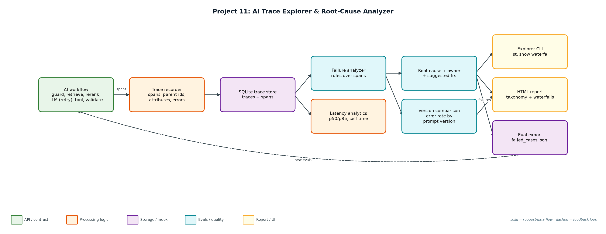
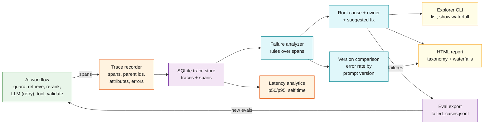

# Project 11: AI Trace Explorer & Root-Cause Analyzer

**Primary topic:** Observability · **Secondary:** Tracing, Debugging, Regression detection, Evals

> Traces every step of an AI workflow, classifies what went wrong, points at the span that caused it, and turns failures into eval cases.

## 1. Problem
When an AI feature gives a bad answer, logs show only the final output. Was it retrieval, the reranker, a 429 storm, a tool outage or the new prompt version? Without step-level traces, every incident becomes guesswork and the same failure ships again.

### Why it matters
- AI failures are multi-step; the root cause is rarely the LLM call.
- Prompt-version regressions only show up in aggregate.
- On-call engineers need an owner and a fix, not a stack trace.
- Failures are the best source of new eval cases.

## 2. Goals and success criteria
| Goal | Success criterion |
|---|---|
| Step-level tracing | OpenTelemetry-shaped spans with parent ids and attributes in SQLite |
| Failure taxonomy | 9 categories with owner and suggested fix |
| Root cause per trace | Highest-severity, earliest finding; 100% vs injected faults |
| Regression detection | Error rate and categories by prompt version |
| Close the loop | Failing traces exported as draft eval cases |

### Non-goals
- Replacing Langfuse/Phoenix/Datadog: the span schema is OTel-shaped so it can export there.
- Real provider calls: a simulated clock and seeded faults make 300 traces run instantly.

## 3. Architecture




### Components
| Component | File | Responsibility |
|---|---|---|
| Span model + store | trace_store.py | SimClock, TraceRecorder with nested spans, SQLite persistence and queries. |
| Workflow + faults | workflow.py | Six-step support workflow with retries and 8 seeded fault types; prompt v8 adds a JSON regression. |
| Analyzer | analyzer.py | Rules over spans, severity ordering, owner/hint taxonomy, self-time. |
| Explorer CLI | explorer.py | simulate, summary, list, show (ASCII waterfall), report (HTML), export. |
| Outputs | reports/, evals/ | trace_report.html and failed_cases.jsonl. |

## 4. Request / data flow
1. Each request opens a root span; each step opens a child span with attributes (hits, tokens, grounding, HTTP status).
2. Errors propagate up the span tree; 429 retries are separate error spans followed by a successful attempt.
3. Traces and spans are stored in SQLite.
4. The analyzer applies rules per span: timeouts, context overflow, tool errors, invalid JSON, empty retrieval, low grounding, latency SLOs, 429s.
5. Findings are ordered by severity and time; the first one is the root cause, with an owner and a suggested fix.
6. Aggregates show the taxonomy, p50/p95 per span, where time goes and error rate by prompt version.
7. Failing traces are exported as draft eval cases for the dataset builder (Project 5).

## 5. Key design decisions
| Decision | Why | Trade-off |
|---|---|---|
| OTel-shaped spans | Portable to Langfuse, Phoenix, Jaeger. | More fields than a flat log. |
| Rules before an LLM judge | Deterministic, cheap, explainable root causes. | New failure types need new rules. |
| Severity, then time | A timeout outranks a slow rerank in the same trace. | Secondary causes are listed, not ranked. |
| Simulated clock | Thousands of traces in seconds, reproducible. | No real network jitter. |
| Owner per category | Routes incidents to the right team. | Ownership map must be maintained. |

## 6. Evaluation and metrics
- 300 traces, 18% hard failures; root-cause accuracy vs injected faults 111/111 with 0 false alarms on healthy traces.
- Detected the prompt regression: support-v8 had 29 schema_invalid vs 9 for v7 (error rate 12.7% -> 23.3%).
- Latency: request p95 3.6 s; the LLM call is 93% of self time, so reranker tuning would not help.
- 90 failing traces exported as draft eval cases.
- 3 unit tests: span nesting/persistence, classifier vs injected faults, error propagation.

## 7. How to run
```bash
python explorer.py demo
python explorer.py simulate --n 300 && python explorer.py summary
python explorer.py list --category schema_invalid
python explorer.py show <trace_id>
python -m unittest discover -s tests
```

### Sample output
`python3 explorer.py demo`

```text
Simulated 300 traces; injected faults: {'none': 176, 'schema_invalid': 38, 'retrieval_empty': 19, 'ungrounded': 17, 'rate_limited': 14, 'tool_error': 11, 'slow_rerank': 10, 'llm_timeout': 10, 'context_overflow': 5}

Traces: 300 · hard failures: 54 (18%) · traces with any finding: 111

Root-cause taxonomy (owner -> suggested fix):
   38  schema_invalid           [prompt] Output was not valid JSON: use structured output / JSON mode; compare prompt versions.
   19  retrieval_empty          [rag] No documents retrieved: check query rewriting and index freshness before blaming the model.
   17  ungrounded               [quality] Answer has low grounding and no citations: enforce citations via the output guardrail.
   11  rate_limited_recovered   [platform] Recovered after 429 retries; latency cost of backoff is visible in the waterfall.
   10  latency_slo              [performance] Span exceeded its latency SLO: profile this dependency or cache its results.
   10  llm_timeout              [provider] Set a per-call timeout budget and fail over to a second model (gateway routing).
    4  tool_error               [integrations] Downstream API failed: add a circuit breaker and a graceful 'cannot check order' answer.
    2  context_overflow         [rag] Retrieved context exceeds the model window: lower k, trim chunks or summarise before generation.
Root-cause accuracy vs injected faults: 111/111 (100%) · false alarms on healthy traces: 0

Latency by span (p50 / p95 ms):
  request                  1908     3623
  retrieve                   67       88
  rerank                     44       60
  llm.generate             1670     2415
  tool.lookup_order          99      132
Where time goes (self time): llm.generate 93%, rerank 3%, retrieve 2%

By prompt version:
  support-v7: error rate 12.7% · schema_invalid 9 of 150
  support-v8: error rate 23.3% · schema_invalid 29 of 150
  REGRESSION: support-v8 schema_invalid 29 vs 9 in v7 -> roll back or fix the prompt's JSON instructions

Example trace b78e429dee9a42ce (rate_limited_recovered):
  request                  |########################################|     4127 ms 
    guard.input            |#                                       |        5 ms 
    retrieve               |#                                       |       55 ms 
    rerank                 |#                                       |       32 ms 
    llm.generate           |XXXXXX                                  |      622 ms HTTP 429 rate limited
    llm.generate           |      XXXXXXXXXXX                       |     1112 ms HTTP 429 rate limited
    llm.generate           |                 #####################  |     2190 ms 
    tool.lookup_order      |                                      # |      106 ms 
    validate.output        |                                       #|        5 ms 

Wrote reports/trace_report.html
... (1 more lines)
```

## 8. Project structure
| Path | Purpose |
|---|---|
| trace_store.py | Span model and SQLite store |
| workflow.py | Traced workflow with fault injection |
| analyzer.py | Failure taxonomy and root cause |
| explorer.py | CLI, HTML report, eval export |
| data/traces.db | Trace database |

## 9. Interview talking points
- Most AI incidents are not the model: here a third of root causes were retrieval or integrations.
- Self-time analysis showed 93% of latency is generation, so I would not spend time on the reranker.
- Comparing prompt versions caught a 3x JSON-failure regression the day it shipped.
- Every root cause has an owner and a fix, which is what on-call actually needs.
- Failures flow straight into the eval dataset, so each incident becomes a regression test.

## 10. Production roadmap
- Emit real OpenTelemetry spans (OTLP) and view them in Phoenix/Langfuse alongside this analyzer.
- LLM-assisted root-cause summaries for traces the rules cannot classify.
- Alerting on category spikes per prompt version, wired into the rollout monitor (Project 13).
- Streamlit explorer with search by user, feature and version.

## 11. Resume bullet
> Built an AI trace explorer with OTel-shaped spans, a 9-category failure taxonomy and owner-routed fix hints; diagnosed 111/111 injected faults, caught a prompt-version regression (3x JSON failures) and exported 90 failures as eval cases.
