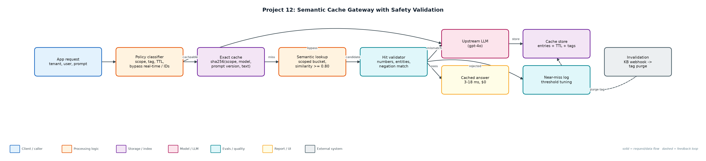
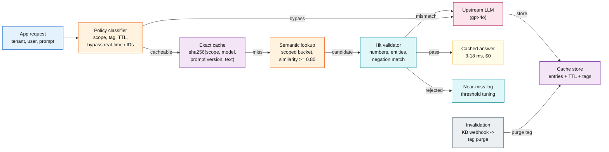

# Project 12: Semantic Cache Gateway with Safety Validation

`LLMOps` `Cost optimisation` `Latency` `Multi-tenancy` `Cache invalidation`

An LLM gateway cache that reuses answers for paraphrased questions while proving it never serves the wrong tenant, entity or stale price.

## Goals
| Goal | Success criterion |
|---|---|
| Two-tier cache | Exact hash, then semantic similarity within scope |
| Scoped by default | global / tenant / user scope; fail closed on personal or account words |
| Hit validation | Numbers, entities and negation must match before reuse |
| TTL + tag invalidation | pricing 24h, docs 7d, account 1h, real-time never cached |
| Measured safety | Ground-truth answer ids; wrong-hit count per config and threshold |

## Architecture


<details><summary>Mermaid source</summary>


</details>

## Quick start
No third-party packages needed (Python 3.10+).

```bash
python simulate.py
python -m unittest discover -s tests
```

## Sample output
```text
2,000 requests · 3 tenants · pricing changes at request 1000 · threshold 0.8

config                     hit rate  exact semantic  bypass  wrong   cost $  saved  p50 ms  p95 ms
no_cache                       0.0%      0        0     141      0    6.450     0%    2620    2620
exact_only                    31.8%    636        0     141      0    4.399    32%    2638    2638
semantic_unvalidated          58.4%    183      984     141      4    2.686    58%      18    2638
semantic_no_invalidation      59.7%    198      996     141    141    2.599    60%      18    2638
semantic_validated            58.1%    183      979     141      0    2.703    58%      18    2638

semantic_unvalidated wrong hits, e.g.:
  'sorry to bother, How much does the starter plan cost?' got answer for price:pro:v1 (truth price:starter:v1, sim 0.832)
  'hey - I do not want to reset my password, how do I keep it? - urgent' got answer for reset_password (truth keep_password, sim 0.832)

semantic_no_invalidation wrong hits, e.g.:
  'what does the pro plan cost' got answer for price:pro:v1 (truth price:pro:v2, sim 1.0)
  'hi, price of the entreprise plan' got answer for price:enterprise:v1 (truth price:enterprise:v2, sim 0.81)

semantic_validated wrong hits, e.g.:

Near-miss log (semantic_validated): 176 entries {'below threshold': 170, 'entity/number/negation mismatch': 6}
  blocked: 'sorry to bother, How much does the starter plan cost?' vs cached 'sorry to bother, How much does the pro plan cost?' (sim 0.832)
  blocked: 'How much is the enterrpise plan per user?' vs cached 'How much is the enterprise plan per user?' (sim 0.818)

Threshold sweep (validated, with invalidation):
  0.60: hit rate 71.8%  wrong   1  (without validator:  95 wrong)
  0.70: hit rate 66.7%  wrong   1  (without validator:  13 wrong)
  0.75: hit rate 63.3%  wrong   0  (without validator:  10 wrong)
  0.80: hit rate 58.1%  wrong   0  (without validator:   4 wrong)
  0.85: hit rate 53.2%  wrong   0  (without validator:   0 wrong)
  0.90: hit rate 45.9%  wrong   0  (without validator:   0 wrong)
  0.95: hit rate 38.9%  wrong   0  (without validator:   0 wrong)

Wrote reports/results.json and reports/near_misses.jsonl
```

## Files
| Path | Purpose |
|---|---|
| cache.py | Cache tiers, policy, validator |
| gateway.py | Gateway integration |
| workload.py | Seeded traffic with ground truth |
| simulate.py | Experiments and sweep |
| reports/ | results.json, near_misses.jsonl |

## Documentation
- [docs/PROJECT_EXPLANATION.md](docs/PROJECT_EXPLANATION.md) · [docs/PROJECT_EXPLANATION.docx](docs/PROJECT_EXPLANATION.docx): full explanation
- [docs/PRESENTATION.pptx](docs/PRESENTATION.pptx): slide deck for walkthroughs and interviews
