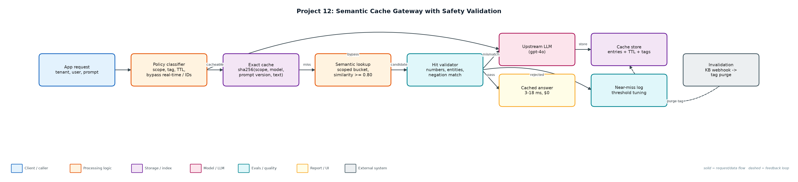
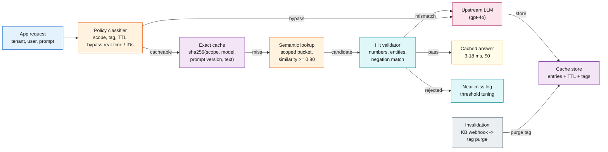

# Project 12: Semantic Cache Gateway with Safety Validation

**Primary topic:** LLMOps · **Secondary:** Cost optimisation, Latency, Multi-tenancy, Cache invalidation

> An LLM gateway cache that reuses answers for paraphrased questions while proving it never serves the wrong tenant, entity or stale price.

## 1. Problem
Support traffic repeats: 'how do I reset my password' arrives in a hundred phrasings. Caching saves cost and latency, but a naive semantic cache serves the Pro price to a Starter question, leaks one tenant's seat count to another, and keeps quoting last month's pricing.

### Why it matters
- LLM calls are the dominant cost and latency in most AI features.
- Wrong cache hits are confident, fast, and invisible without ground truth.
- Multi-tenant SaaS cannot share account-specific answers.
- Content changes must invalidate cached answers immediately.

## 2. Goals and success criteria
| Goal | Success criterion |
|---|---|
| Two-tier cache | Exact hash, then semantic similarity within scope |
| Scoped by default | global / tenant / user scope; fail closed on personal or account words |
| Hit validation | Numbers, entities and negation must match before reuse |
| TTL + tag invalidation | pricing 24h, docs 7d, account 1h, real-time never cached |
| Measured safety | Ground-truth answer ids; wrong-hit count per config and threshold |

### Non-goals
- A production vector store: an in-memory scoped index stands in for Redis/pgvector.
- Caching streamed partial responses.

## 3. Architecture




### Components
| Component | File | Responsibility |
|---|---|---|
| Cache | cache.py | Policy classifier, signature validator, exact + scoped semantic tiers, TTL, tag invalidation, near-miss log. |
| Gateway | gateway.py | Lookup -> upstream on miss -> store; cost and latency from the shared pricing registry. |
| Workload | workload.py | 2,000 seeded requests across 3 tenants with paraphrases, typos, entities, account and real-time queries. |
| Simulation | simulate.py | Five configurations, threshold sweep, wrong-hit examples, near-miss export. |

## 4. Request / data flow
1. Classify the prompt: real-time or ID-bearing prompts bypass the cache; personal/account prompts get tenant scope; others are global with a tag and TTL.
2. Exact tier: hash of scope, model, prompt version and normalised text.
3. Semantic tier: compare against entries in the same scope and prompt version only; take the best match above the threshold.
4. Validate the candidate: numbers, product entities and negation must be identical; otherwise log a near-miss and call the model.
5. On a miss, call the upstream model and store the answer with its tag and expiry.
6. When the KB changes (pricing at request 1,000), purge every entry with that tag.
7. Score every response against ground-truth answer ids to count wrong hits.

## 5. Key design decisions
| Decision | Why | Trade-off |
|---|---|---|
| Fail-closed scoping | A typo ('acocunt') leaked seat counts across tenants until scope defaulted to tenant on account words. | Fewer global hits. |
| Validator after similarity | 'starter' vs 'pro' scored 0.83 similar. | Misses some safe reuse (typos in entity names). |
| Cache key includes prompt version + model | A prompt change must not serve old outputs. | Cold cache after each release. |
| Tags over TTL alone | Pricing changed mid-day; TTL would serve stale prices for hours. | Needs a webhook from content owners. |
| Threshold from a sweep | 0.75 was the lowest with zero wrong hits; 0.80 adds margin. | Re-sweep when traffic changes. |

## 6. Evaluation and metrics
- 2,000 requests: validated semantic cache hit 58.1% with 0 wrong hits, cutting cost 58% ($6.45 -> $2.70) and p50 latency 2.6 s -> 18 ms.
- Exact-only caching reached 31.8%; semantic nearly doubled it.
- Without the validator: 4 wrong hits at 0.80 and 95 at 0.60 (e.g. Starter question served the Pro price).
- Without tag invalidation: 141 stale pricing answers after the price change.
- 5 unit tests: paraphrase hit, entity mismatch, tenant isolation, real-time bypass, invalidation + TTL.

## 7. How to run
```bash
python simulate.py
python -m unittest discover -s tests
```

### Sample output
`python3 simulate.py`

```text
2,000 requests · 3 tenants · pricing changes at request 1000 · threshold 0.8

config                     hit rate  exact semantic  bypass  wrong   cost $  saved  p50 ms  p95 ms
no_cache                       0.0%      0        0     141      0    6.450     0%    2620    2620
exact_only                    31.8%    636        0     141      0    4.399    32%    2638    2638
semantic_unvalidated          58.4%    183      984     141      4    2.686    58%      18    2638
semantic_no_invalidation      59.7%    198      996     141    141    2.599    60%      18    2638
semantic_validated            58.1%    183      979     141      0    2.703    58%      18    2638

semantic_unvalidated wrong hits, e.g.:
  'sorry to bother, How much does the starter plan cost?' got answer for price:pro:v1 (truth price:starter:v1, sim 0.832)
  'hey - I do not want to reset my password, how do I keep it? - urgent' got answer for reset_password (truth keep_password, sim 0.832)

semantic_no_invalidation wrong hits, e.g.:
  'what does the pro plan cost' got answer for price:pro:v1 (truth price:pro:v2, sim 1.0)
  'hi, price of the entreprise plan' got answer for price:enterprise:v1 (truth price:enterprise:v2, sim 0.81)

semantic_validated wrong hits, e.g.:

Near-miss log (semantic_validated): 176 entries {'below threshold': 170, 'entity/number/negation mismatch': 6}
  blocked: 'sorry to bother, How much does the starter plan cost?' vs cached 'sorry to bother, How much does the pro plan cost?' (sim 0.832)
  blocked: 'How much is the enterrpise plan per user?' vs cached 'How much is the enterprise plan per user?' (sim 0.818)

Threshold sweep (validated, with invalidation):
  0.60: hit rate 71.8%  wrong   1  (without validator:  95 wrong)
  0.70: hit rate 66.7%  wrong   1  (without validator:  13 wrong)
  0.75: hit rate 63.3%  wrong   0  (without validator:  10 wrong)
  0.80: hit rate 58.1%  wrong   0  (without validator:   4 wrong)
  0.85: hit rate 53.2%  wrong   0  (without validator:   0 wrong)
  0.90: hit rate 45.9%  wrong   0  (without validator:   0 wrong)
  0.95: hit rate 38.9%  wrong   0  (without validator:   0 wrong)

Wrote reports/results.json and reports/near_misses.jsonl
```

## 8. Project structure
| Path | Purpose |
|---|---|
| cache.py | Cache tiers, policy, validator |
| gateway.py | Gateway integration |
| workload.py | Seeded traffic with ground truth |
| simulate.py | Experiments and sweep |
| reports/ | results.json, near_misses.jsonl |

## 9. Interview talking points
- A semantic cache is a correctness problem before it is a cost problem; I measured wrong hits against ground truth.
- Similarity alone confused Starter and Pro pricing at 0.83; a cheap entity/number check fixed it.
- Scope fails closed: anything personal or account-related never leaves the tenant.
- Tag invalidation prevented 141 stale price quotes after a pricing change.
- Result: 58% cost reduction and 18 ms p50 for cached answers with zero wrong hits.

## 10. Production roadmap
- Redis + vector index (RedisVL / pgvector) with per-tenant namespaces.
- Real embedding model and an LLM-judge spot-check on a sample of semantic hits.
- Expose hit/miss/near-miss metrics in Prometheus and alert on wrong-hit reports.
- Integrate with the spend gateway (Project 3) so the cache runs before routing.

## 11. Resume bullet
> Built a multi-tenant semantic cache gateway with fail-closed scoping, entity/number validation and tag invalidation, cutting LLM cost 58% and p50 latency from 2.6 s to 18 ms with zero wrong hits across 2,000 requests.
