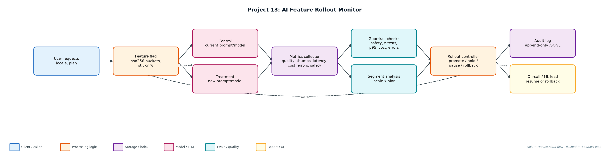
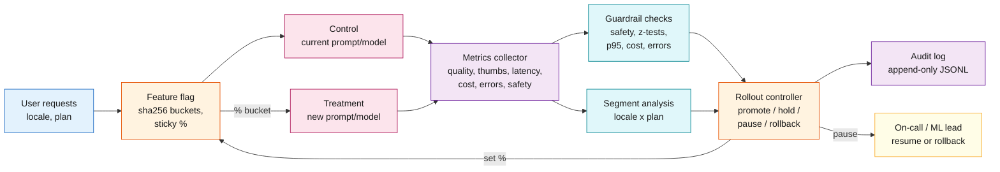

# Project 13: AI Feature Rollout Monitor

`LLMOps` `Progressive delivery` `A/B statistics` `Guardrails` `Audit`

Ships a new model or prompt through 1% -> 5% -> 25% -> 50% -> 100% with statistical quality checks, segment analysis, automatic pause/rollback and a full audit trail.

## Goals
| Goal | Success criterion |
|---|---|
| Sticky, monotonic assignment | Consistent hashing; raising % only adds users |
| Staged rollout | 1 / 5 / 25 / 50 / 100% with minimum samples per stage |
| Statistical guardrails | One-sided z-tests on bad-answer and thumbs-down rates |
| Segment analysis | Per-locale and per-plan tests catch hidden regressions |
| Automatic actions + audit | promote / hold / pause / rollback, every decision logged |

## Architecture


<details><summary>Mermaid source</summary>


</details>

## Quick start
No third-party packages needed (Python 3.10+).

```bash
python simulate.py
python simulate.py --scenario segment_regression
python -m unittest discover -s tests
```

## Sample output
```text
Power check: detecting a +2pp rise in an 8% bad-answer rate needs ~2,532 samples per arm (guardrail minimum per stage: 400; small stages only catch large regressions).

=== healthy_candidate ===
  hour 12 @   1%: PROMOTE  guardrails green with 425 treatment samples  [treatment n=425, bad=7.1%, p95=1895 ms]
  hour 15 @   5%: PROMOTE  guardrails green with 560 treatment samples  [treatment n=560, bad=5.4%, p95=1962 ms]
  hour 16 @  25%: PROMOTE  guardrails green with 994 treatment samples  [treatment n=994, bad=6.1%, p95=1969 ms]
  hour 17 @  50%: PROMOTE  guardrails green with 1991 treatment samples  [treatment n=1991, bad=6.7%, p95=1980 ms]
  hour 18 @ 100%: COMPLETE all guardrails green at 100%  [treatment n=4000, bad=7.2%, p95=1991 ms]
  final state: complete · max users exposed: 50,000 of 50,000 · audit -> audit/healthy_candidate.jsonl

=== segment_regression ===
  hour 12 @   1%: PROMOTE  guardrails green with 425 treatment samples  [treatment n=425, bad=10.1%, p95=2067 ms]
  hour 15 @   5%: PROMOTE  guardrails green with 560 treatment samples  [treatment n=560, bad=7.5%, p95=2141 ms]
  hour 16 @  25%: PAUSE    segment locale=de: bad_quality +17.6% (p=0.0000, n=137)  [treatment n=994, bad=8.4%, p95=2148 ms]
  hour 16: human reviewed segment breakdown -> rollback to 0%
  final state: rolled_back · max users exposed: 12,586 of 50,000 · audit -> audit/segment_regression.jsonl

=== safety_incident ===
  hour  5 @   1%: ROLLBACK 2 safety violations (1.14% > 0.20%)  [treatment n=175, bad=8.6%, p95=1937 ms]
  final state: rolled_back · max users exposed: 468 of 50,000 · audit -> audit/safety_incident.jsonl

=== latency_regression ===
  hour 12 @   1%: PAUSE    p95 latency 3014 ms vs 2136 ms (x1.41)  [treatment n=425, bad=7.8%, p95=3014 ms]
  hour 12: human rollback by on-call -> 0%
  final state: rolled_back · max users exposed: 468 of 50,000 · audit -> audit/latency_regression.jsonl
```

## Files
| Path | Purpose |
|---|---|
| flags.py | Consistent-hash feature flags |
| stats_tests.py | z-test and sample size |
| rollout.py | Controller and guardrails |
| simulate.py | Four rollout scenarios |
| audit/ | Decision audit logs |

## Documentation
- [docs/PROJECT_EXPLANATION.md](docs/PROJECT_EXPLANATION.md) · [docs/PROJECT_EXPLANATION.docx](docs/PROJECT_EXPLANATION.docx): full explanation
- [docs/PRESENTATION.pptx](docs/PRESENTATION.pptx): slide deck for walkthroughs and interviews
