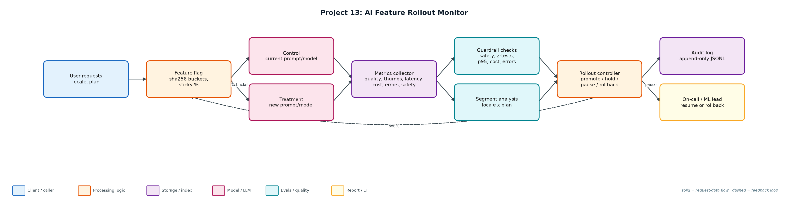
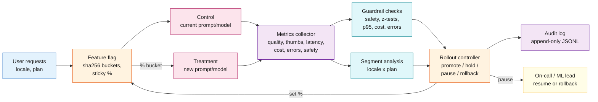

# Project 13: AI Feature Rollout Monitor

**Primary topic:** LLMOps · **Secondary:** Progressive delivery, A/B statistics, Guardrails, Audit

> Ships a new model or prompt through 1% -> 5% -> 25% -> 50% -> 100% with statistical quality checks, segment analysis, automatic pause/rollback and a full audit trail.

## 1. Problem
A new prompt looks better in offline evals, ships to everyone, and German users get worse answers for a week before anyone notices. AI changes need the same progressive delivery as code, but judged on quality, safety, latency and cost, with statistics that respect small samples.

### Why it matters
- Offline evals cannot cover every segment of real traffic.
- Average metrics hide segment regressions.
- Safety incidents need immediate automatic rollback, not a dashboard.
- Regulated customers ask who approved each rollout step.

## 2. Goals and success criteria
| Goal | Success criterion |
|---|---|
| Sticky, monotonic assignment | Consistent hashing; raising % only adds users |
| Staged rollout | 1 / 5 / 25 / 50 / 100% with minimum samples per stage |
| Statistical guardrails | One-sided z-tests on bad-answer and thumbs-down rates |
| Segment analysis | Per-locale and per-plan tests catch hidden regressions |
| Automatic actions + audit | promote / hold / pause / rollback, every decision logged |

### Non-goals
- A full experimentation platform (LaunchDarkly/Statsig); this is the AI-specific decision layer.
- Sequential testing corrections beyond a stricter alpha for segments.

## 3. Architecture




### Components
| Component | File | Responsibility |
|---|---|---|
| Feature flags | flags.py | sha256 bucketing per feature; deterministic and monotonic. |
| Statistics | stats_tests.py | One-sided two-proportion z-test and sample-size calculator. |
| Controller | rollout.py | Guardrails config, stage machine, segment tests, decisions, human resume/rollback, audit log. |
| Scenarios | simulate.py | 50k users, 4,000 requests/hour; healthy, segment regression, safety incident, latency regression. |
| Audit trail | audit/*.jsonl | Every decision with metrics snapshot, reasons and actor. |

## 4. Request / data flow
1. Each request's user is hashed into one of 10,000 buckets; the user is in treatment if their bucket is below the stage percentage.
2. Both arms log quality (judge bad answer), thumbs-down, latency, cost, errors and safety violations.
3. Every hour the controller evaluates the current stage.
4. Two or more safety violations above 0.2% roll back immediately, at any sample size.
5. Below 400 treatment samples the decision is hold.
6. Quality and thumbs-down are tested one-sided (alpha 0.01, at least 2pp worse); each locale and plan segment is tested with a stricter alpha.
7. p95 latency above 1.2x, cost above 1.3x or error rate +1pp also pause.
8. Green stages promote; pauses wait for a human to resume or roll back; everything is written to the audit log.

## 5. Key design decisions
| Decision | Why | Trade-off |
|---|---|---|
| Consistent hashing | Users keep a stable experience; metrics are not polluted by flip-flopping. | Bucket skew needs monitoring. |
| Pause, not auto-rollback, for quality | Quality signals can be noisy; a human decides. | Slower reaction to quality issues. |
| Auto-rollback for safety | Harm outweighs false-positive cost. | Requires a trustworthy safety classifier. |
| Segment tests with stricter alpha | Many segments means many tests. | Small segments only catch large regressions. |
| Minimum samples per stage | Avoids promoting on noise at 1%. | Early stages take longer. |

## 6. Evaluation and metrics
- Healthy candidate: promoted 1 -> 5 -> 25 -> 50 -> 100% in 18 simulated hours with all guardrails green.
- Segment regression (German answers 21% bad vs 8%): overall looked fine; caught at 25% by the locale=de test (+17.6pp) and rolled back.
- Safety incident: rolled back at 1% after 2 violations; at most 468 of 50,000 users exposed.
- Latency regression (p95 x1.41): paused at 1% and rolled back by on-call.
- Power check: detecting +2pp on an 8% base needs ~2,500 samples per arm, which explains why early stages only catch large effects.
- 6 unit tests: sticky assignment, z-test, hold, safety rollback, latency pause + audit, segment scenario.

## 7. How to run
```bash
python simulate.py
python simulate.py --scenario segment_regression
python -m unittest discover -s tests
```

### Sample output
`python3 simulate.py`

```text
Power check: detecting a +2pp rise in an 8% bad-answer rate needs ~2,532 samples per arm (guardrail minimum per stage: 400; small stages only catch large regressions).

=== healthy_candidate ===
  hour 12 @   1%: PROMOTE  guardrails green with 425 treatment samples  [treatment n=425, bad=7.1%, p95=1895 ms]
  hour 15 @   5%: PROMOTE  guardrails green with 560 treatment samples  [treatment n=560, bad=5.4%, p95=1962 ms]
  hour 16 @  25%: PROMOTE  guardrails green with 994 treatment samples  [treatment n=994, bad=6.1%, p95=1969 ms]
  hour 17 @  50%: PROMOTE  guardrails green with 1991 treatment samples  [treatment n=1991, bad=6.7%, p95=1980 ms]
  hour 18 @ 100%: COMPLETE all guardrails green at 100%  [treatment n=4000, bad=7.2%, p95=1991 ms]
  final state: complete · max users exposed: 50,000 of 50,000 · audit -> audit/healthy_candidate.jsonl

=== segment_regression ===
  hour 12 @   1%: PROMOTE  guardrails green with 425 treatment samples  [treatment n=425, bad=10.1%, p95=2067 ms]
  hour 15 @   5%: PROMOTE  guardrails green with 560 treatment samples  [treatment n=560, bad=7.5%, p95=2141 ms]
  hour 16 @  25%: PAUSE    segment locale=de: bad_quality +17.6% (p=0.0000, n=137)  [treatment n=994, bad=8.4%, p95=2148 ms]
  hour 16: human reviewed segment breakdown -> rollback to 0%
  final state: rolled_back · max users exposed: 12,586 of 50,000 · audit -> audit/segment_regression.jsonl

=== safety_incident ===
  hour  5 @   1%: ROLLBACK 2 safety violations (1.14% > 0.20%)  [treatment n=175, bad=8.6%, p95=1937 ms]
  final state: rolled_back · max users exposed: 468 of 50,000 · audit -> audit/safety_incident.jsonl

=== latency_regression ===
  hour 12 @   1%: PAUSE    p95 latency 3014 ms vs 2136 ms (x1.41)  [treatment n=425, bad=7.8%, p95=3014 ms]
  hour 12: human rollback by on-call -> 0%
  final state: rolled_back · max users exposed: 468 of 50,000 · audit -> audit/latency_regression.jsonl
```

## 8. Project structure
| Path | Purpose |
|---|---|
| flags.py | Consistent-hash feature flags |
| stats_tests.py | z-test and sample size |
| rollout.py | Controller and guardrails |
| simulate.py | Four rollout scenarios |
| audit/ | Decision audit logs |

## 9. Interview talking points
- AI changes deserve progressive delivery: prompts and models are deployments.
- The average hid a German-locale regression; segment tests caught it at 25% exposure.
- Safety rolls back automatically; quality pauses for a human, because the cost of each error is different.
- I show the power calculation so stakeholders understand what 1% can and cannot detect.
- Every decision is in an append-only audit log with the metrics that justified it.

## 10. Production roadmap
- Integrate with LaunchDarkly/Unleash for flag delivery and a warehouse for metrics.
- Use the eval service (Project 14) as the online quality judge on sampled traffic.
- Sequential testing (mSPRT) so stages can stop early safely.
- Slack approvals for resume with the segment breakdown attached.

## 11. Resume bullet
> Built an AI rollout controller with sticky hashing, staged exposure, z-tested quality guardrails and segment analysis; caught a hidden German-locale regression at 25% and auto-rolled back a safety incident with <1% of users exposed.
