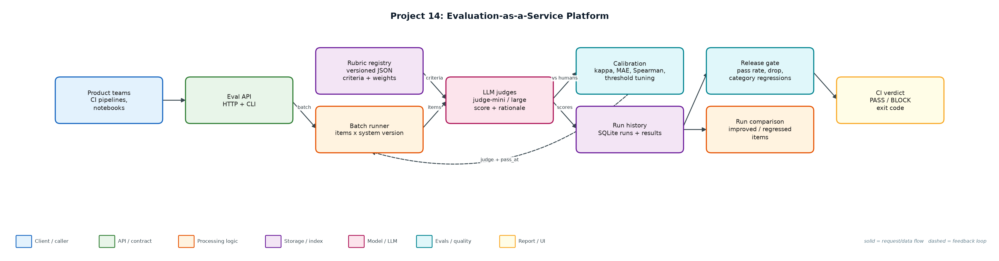
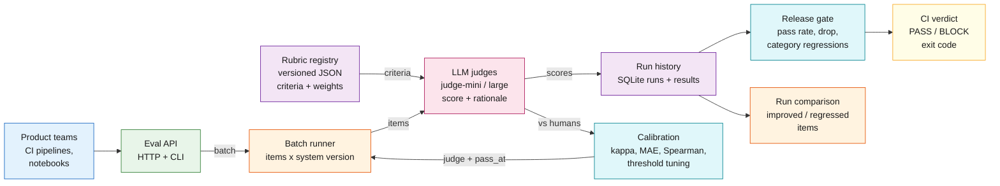

# Project 14: Evaluation-as-a-Service Platform

`Evals` `LLM-as-judge` `Calibration` `CI gating` `Platform API`

A shared evaluation service: versioned rubrics, LLM judges calibrated against human labels, batch runs with history, and a release gate any team can call from CI or HTTP.

## Goals
| Goal | Success criterion |
|---|---|
| Versioned rubrics | Weighted criteria, scale, pass mark and judge prompt in JSON |
| Calibrate judges vs humans | kappa, MAE, Spearman, bias; human-human agreement as ceiling |
| Tune the pass threshold | Per judge, to maximise agreement with human pass/fail |
| Batch runs with history | SQLite runs + per-item results; compare runs |
| Gate + API | CLI exit code for CI; HTTP POST /evaluate, GET /runs |

## Architecture


<details><summary>Mermaid source</summary>


</details>

## Quick start
No third-party packages needed (Python 3.10+).

```bash
python generate_data.py
python eval_cli.py demo
python eval_cli.py calibrate
python eval_cli.py gate --baseline v1 --candidate v2   # exit 1 on BLOCK
python eval_cli.py serve --port 8714
python -m unittest discover -s tests
```

## Sample output
```text
Calibration set: 120 items with two human annotators
  human-human agreement (pass/fail kappa): 0.75  <- ceiling for any judge
  judge-mini   kappa=0.607  MAE=0.708  spearman=0.799  bias=+0.54  -> tuned pass_at=5 kappa=0.734  ($0.40/1k)
  judge-large  kappa=0.687  MAE=0.383  spearman=0.874  bias=+0.07  -> tuned pass_at=4 kappa=0.687  ($6.00/1k)
  chosen: judge-mini with pass_at=5 (cheapest judge with tuned kappa >= 0.6)

Batch eval with judge-mini (pass_at=5), rubric support_answer@2.0.0, 150 items
  v1: mean 3.91, pass rate 50.0%  (run a987a30a2d)
  v2: mean 3.83, pass rate 52.7%  (run 08765bbef2)  judge cost $0.060
  per item: 32 improved, 36 regressed, 82 unchanged
  by category: api 32%->64%, billing 50%->46%, export 53%->61%, refund 68%->25%, sso 47%->62%
Gate: BLOCK - category 'refund' pass rate 68% -> 25%

HTTP POST /evaluate -> run 981be789f3: mean 3.5, pass rate 50%

CI exit code would be 1
```

## Files
| Path | Purpose |
|---|---|
| rubrics/ | Versioned rubric definitions |
| judges.py | Judges |
| calibration.py | Agreement metrics and tuning |
| service.py | Runs, comparison, gate |
| server.py / eval_cli.py | HTTP API and CLI |
| data/ | items.jsonl, evals.db |

## Documentation
- [docs/PROJECT_EXPLANATION.md](docs/PROJECT_EXPLANATION.md) · [docs/PROJECT_EXPLANATION.docx](docs/PROJECT_EXPLANATION.docx): full explanation
- [docs/PRESENTATION.pptx](docs/PRESENTATION.pptx): slide deck for walkthroughs and interviews
