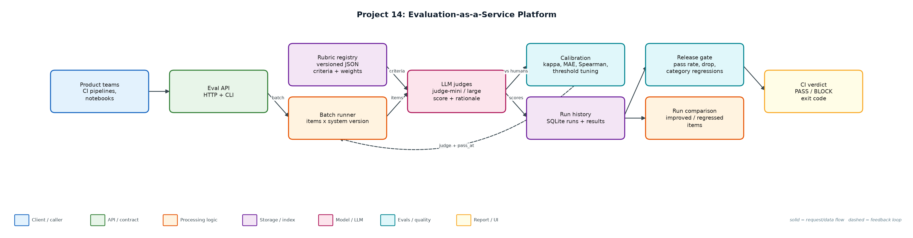
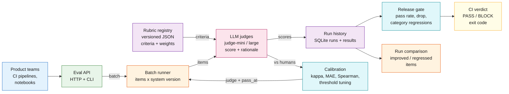

# Project 14: Evaluation-as-a-Service Platform

**Primary topic:** Evals · **Secondary:** LLM-as-judge, Calibration, CI gating, Platform API

> A shared evaluation service: versioned rubrics, LLM judges calibrated against human labels, batch runs with history, and a release gate any team can call from CI or HTTP.

## 1. Problem
Every team writes its own eval script with its own judge prompt and nobody knows whether the judge agrees with humans. Scores are not comparable across teams or over time, and releases still ship on vibes.

### Why it matters
- An uncalibrated judge is just another opinion.
- Judge cost scales with every PR; the cheapest judge that matches humans wins.
- Averages hide category regressions (refunds got worse while the total improved).
- A platform team multiplies eval quality across all AI features.

## 2. Goals and success criteria
| Goal | Success criterion |
|---|---|
| Versioned rubrics | Weighted criteria, scale, pass mark and judge prompt in JSON |
| Calibrate judges vs humans | kappa, MAE, Spearman, bias; human-human agreement as ceiling |
| Tune the pass threshold | Per judge, to maximise agreement with human pass/fail |
| Batch runs with history | SQLite runs + per-item results; compare runs |
| Gate + API | CLI exit code for CI; HTTP POST /evaluate, GET /runs |

### Non-goals
- Real LLM judge calls: judges score observable features with model-specific noise and leniency; the rubric's judge_prompt is ready for a real model.
- A labelling UI; human labels come from two simulated annotators.

## 3. Architecture




### Components
| Component | File | Responsibility |
|---|---|---|
| Data generator | generate_data.py | 150 support items, v1/v2 outputs with hidden true quality, 120 with two human annotators. |
| Rubric | rubrics/support_answer.v2.json | Correctness 0.5, grounding 0.2, no unsupported claims 0.2, concise 0.1; pass at 4. |
| Judges | judges.py | Rubric-driven scoring with per-judge noise, leniency and cost. |
| Calibration | calibration.py | Cohen's kappa, MAE, Spearman, bias, threshold tuning. |
| Service + API | service.py, server.py, eval_cli.py | SQLite runs, compare, gate policy, HTTP endpoints, CLI with CI exit codes. |

## 4. Request / data flow
1. A team registers or picks a rubric version.
2. Calibration scores the human-labelled set with each judge and reports kappa, MAE, Spearman and bias against the mean human score.
3. Human-human kappa is the ceiling: no judge should be expected to beat annotator agreement.
4. Each judge's pass threshold is tuned to best reproduce human pass/fail; the cheapest judge with tuned kappa >= 0.6 is selected.
5. Batch runs evaluate every item for a system version and store per-item scores, criteria and rationale.
6. The gate compares candidate and baseline: absolute pass rate, overall drop and per-category drops.
7. CI calls the CLI (exit 1 on BLOCK) or POSTs to /evaluate.

## 5. Key design decisions
| Decision | Why | Trade-off |
|---|---|---|
| Calibrate before trusting | The mini judge was +0.54 lenient out of the box. | Needs a human-labelled set per rubric. |
| Tune thresholds per judge | Raising mini's pass mark to 5 gave kappa 0.734. | Threshold must be re-tuned when judge or rubric changes. |
| Cheapest judge that clears the bar | Mini is 15x cheaper than large at equal agreement. | Re-check when traffic distribution shifts. |
| Category-level gate | Overall pass rate went up while refunds fell from 68% to 25%. | Small categories are noisy. |
| Human-human ceiling | Sets realistic expectations for judge agreement. | Requires double annotation. |

## 6. Evaluation and metrics
- Human-human pass/fail kappa 0.75 on 120 double-labelled items.
- Out of the box: judge-mini kappa 0.607 (bias +0.54), judge-large kappa 0.687 (bias +0.07).
- After threshold tuning, judge-mini reached kappa 0.734 at $0.40/1k vs $6.00/1k for large, so the service selects mini.
- Gate: v2 improved overall pass rate (50.0% -> 52.7%) but was BLOCKED for the refund regression (68% -> 25%).
- HTTP POST /evaluate round-trip verified; 4 unit tests (metrics, judge, gate, HTTP).

## 7. How to run
```bash
python generate_data.py
python eval_cli.py demo
python eval_cli.py calibrate
python eval_cli.py gate --baseline v1 --candidate v2   # exit 1 on BLOCK
python eval_cli.py serve --port 8714
python -m unittest discover -s tests
```

### Sample output
`python3 eval_cli.py demo`

```text
Calibration set: 120 items with two human annotators
  human-human agreement (pass/fail kappa): 0.75  <- ceiling for any judge
  judge-mini   kappa=0.607  MAE=0.708  spearman=0.799  bias=+0.54  -> tuned pass_at=5 kappa=0.734  ($0.40/1k)
  judge-large  kappa=0.687  MAE=0.383  spearman=0.874  bias=+0.07  -> tuned pass_at=4 kappa=0.687  ($6.00/1k)
  chosen: judge-mini with pass_at=5 (cheapest judge with tuned kappa >= 0.6)

Batch eval with judge-mini (pass_at=5), rubric support_answer@2.0.0, 150 items
  v1: mean 3.91, pass rate 50.0%  (run a987a30a2d)
  v2: mean 3.83, pass rate 52.7%  (run 08765bbef2)  judge cost $0.060
  per item: 32 improved, 36 regressed, 82 unchanged
  by category: api 32%->64%, billing 50%->46%, export 53%->61%, refund 68%->25%, sso 47%->62%
Gate: BLOCK - category 'refund' pass rate 68% -> 25%

HTTP POST /evaluate -> run 981be789f3: mean 3.5, pass rate 50%

CI exit code would be 1
```

## 8. Project structure
| Path | Purpose |
|---|---|
| rubrics/ | Versioned rubric definitions |
| judges.py | Judges |
| calibration.py | Agreement metrics and tuning |
| service.py | Runs, comparison, gate |
| server.py / eval_cli.py | HTTP API and CLI |
| data/ | items.jsonl, evals.db |

## 9. Interview talking points
- I never trust a judge until it is calibrated: kappa, MAE and bias against two human annotators.
- Human-human agreement (0.75) is the ceiling; the tuned judge reached 0.734.
- Threshold tuning made a 15x cheaper judge as good as the expensive one.
- The gate caught a refund regression hidden inside an overall improvement.
- It is a platform: any team can call one API and get comparable, historical scores.

## 10. Production roadmap
- Real judges (GPT-4o-mini, Claude Haiku/Sonnet) with structured JSON output and the rubric's judge_prompt.
- Postgres + Celery workers for large batches; per-team quotas.
- Active learning: send judge-human disagreements to annotators to grow the calibration set.
- Dashboard of pass rate per rubric and feature over time; wire into Projects 2 and 13.

## 11. Resume bullet
> Built an evaluation-as-a-service platform with versioned rubrics, judges calibrated against human labels (kappa 0.734 vs 0.75 human ceiling), threshold tuning that made a 15x cheaper judge viable, and a CI gate that blocked a hidden category regression.
