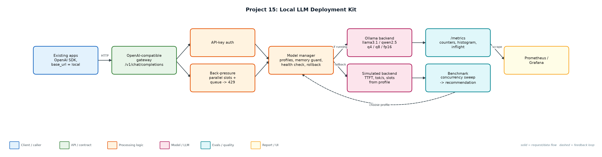
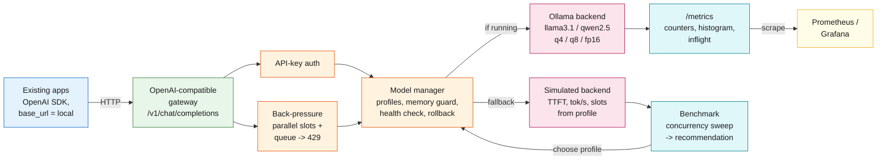

# Project 15: Local LLM Deployment Kit

`Deployment` `Self-hosting` `Quantization` `Observability` `Data residency`

An OpenAI-compatible gateway for local models with quantization benchmarking, back-pressure, Prometheus metrics, health-checked model switching and one-command rollback.

## Goals
| Goal | Success criterion |
|---|---|
| OpenAI-compatible API | /v1/chat/completions (incl. SSE streaming), /v1/models, API keys |
| Quantization benchmark | p50/p95, TTFT, tokens/s, 429s at 1/4/8/16 concurrency per profile |
| Fit to hardware + SLO | Memory budget and p95 SLO pick the highest-quality profile |
| Safe operations | Health-checked switch, memory guard, rollback, back-pressure (429) |
| Observable | Prometheus counters, latency histogram, inflight gauge; docker-compose with Ollama + Prometheus |

## Architecture


<details><summary>Mermaid source</summary>


</details>

## Quick start
No third-party packages needed (Python 3.10+).

```bash
python benchmark.py                       # simulator
python llm_server.py --simulate --port 8815
python benchmark.py --ollama               # after: ollama pull llama3.1:8b-instruct-q4_K_M
cd deploy && docker compose up --build
python -m unittest discover -s tests
```

## Sample output
```text
Hardware: laptop-m2-16gb · memory budget 12 GB · SLO p95 6000 ms · backend SimulatedBackend (time x0.02)

llama3.1-8b:q4_K_M   mem  4.9 GB · quality 0.81
   c=1   p50   1406 ms  p95   1409 ms  ttft   180 ms    25.7 tok/s  429s 0
   c=4   p50   1407 ms  p95   1459 ms  ttft   180 ms    93.1 tok/s  429s 0
   c=8   p50   2627 ms  p95   2814 ms  ttft  1482 ms   101.4 tok/s  429s 0
   c=16  p50   2408 ms  p95   4223 ms  ttft  1289 ms    98.6 tok/s  429s 33
llama3.1-8b:q8_0     mem  8.5 GB · quality 0.84
   c=1   p50   1969 ms  p95   2004 ms  ttft   260 ms    17.8 tok/s  429s 0
   c=4   p50   1976 ms  p95   3773 ms  ttft   260 ms    53.5 tok/s  429s 0
   c=8   p50   5714 ms  p95   5938 ms  ttft  3914 ms    54.3 tok/s  429s 0
   c=16  p50   3968 ms  p95   7781 ms  ttft  2173 ms    48.2 tok/s  429s 37
llama3.1-8b:fp16     SKIPPED: llama3.1-8b:fp16 needs 16.1 GB > budget 12 GB
qwen2.5-3b:q4_K_M    mem  2.1 GB · quality 0.71
   c=1   p50    757 ms  p95    758 ms  ttft    90 ms    44.4 tok/s  429s 0
   c=4   p50    725 ms  p95    790 ms  ttft    90 ms   166.5 tok/s  429s 0
   c=8   p50    784 ms  p95   1202 ms  ttft    90 ms   250.9 tok/s  429s 0
   c=16  p50   1196 ms  p95   1402 ms  ttft   553 ms   254.1 tok/s  429s 0

Recommendation: llama3.1-8b:q8_0 (highest quality meeting p95 <= 6000 ms at 8 concurrent with no 429s)

Ops checks:
  switch to broken-model -> HTTP 409: health check failed, staying on llama3.1-8b:q8_0: model broken-model:q4 failed to load
  switch to fp16 -> HTTP 409: llama3.1-8b:fp16 needs 16.1 GB > budget 12 GB
  switch to qwen2.5-3b -> HTTP 200: active model is now qwen2.5-3b:q4_K_M (previous llama3.1-8b:q8_0)
  rollback -> HTTP 200: rolled back: active model is now llama3.1-8b:q8_0 (previous qwen2.5-3b:q4_K_M)
  streaming -> 8 SSE chunks + [DONE]=True
  wrong API key -> HTTP 401
  /metrics sample:
    llm_requests_total{model="llama3.1-8b:q4_K_M",status="200"} 59
    llm_requests_total{model="llama3.1-8b:q4_K_M",status="429"} 33
    llm_requests_total{model="llama3.1-8b:q8_0",status="200"} 56
    llm_requests_total{model="llama3.1-8b:q8_0",status="429"} 37
    llm_requests_total{model="qwen2.5-3b:q4_K_M",status="200"} 92
    llm_active_model_info{model="llama3.1-8b:q8_0"} 1

Wrote reports/benchmark.json
```

## Files
| Path | Purpose |
|---|---|
| config/models.json | Profiles, hardware, server settings |
| backends.py | Ollama + simulated backends |
| llm_server.py | OpenAI-compatible gateway |
| benchmark.py | Benchmark + ops checks |
| deploy/ | Docker, compose, Prometheus |

## Documentation
- [docs/PROJECT_EXPLANATION.md](docs/PROJECT_EXPLANATION.md) · [docs/PROJECT_EXPLANATION.docx](docs/PROJECT_EXPLANATION.docx): full explanation
- [docs/PRESENTATION.pptx](docs/PRESENTATION.pptx): slide deck for walkthroughs and interviews
