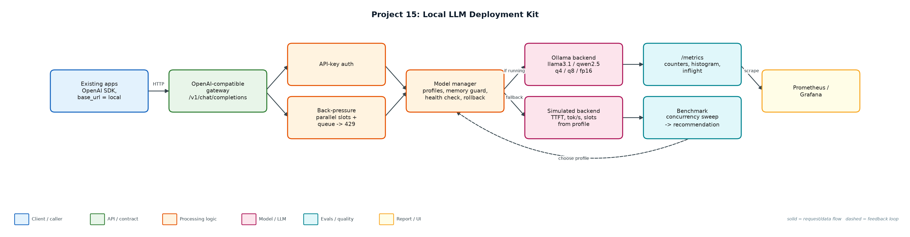
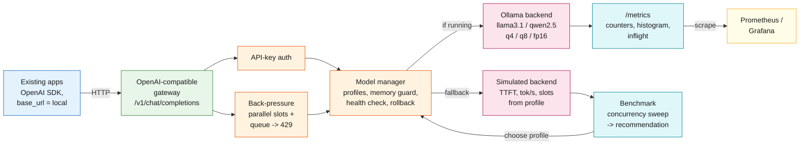

# Project 15: Local LLM Deployment Kit

**Primary topic:** Deployment · **Secondary:** Self-hosting, Quantization, Observability, Data residency

> An OpenAI-compatible gateway for local models with quantization benchmarking, back-pressure, Prometheus metrics, health-checked model switching and one-command rollback.

## 1. Problem
Regulated teams (health, finance, public sector in the EU) often cannot send data to hosted LLM APIs. Running a model locally is easy; running it as a service is not: which quantization fits the hardware and SLO, what happens under concurrent load, how do you swap models safely, and how do you know it is healthy?

### Why it matters
- Data residency and GDPR push workloads on-prem or into private clouds.
- Quantization trades quality for memory and speed; the choice must be measured.
- Local GPUs saturate fast; without back-pressure, latency explodes.
- Existing apps expect the OpenAI API; compatibility makes migration a config change.

## 2. Goals and success criteria
| Goal | Success criterion |
|---|---|
| OpenAI-compatible API | /v1/chat/completions (incl. SSE streaming), /v1/models, API keys |
| Quantization benchmark | p50/p95, TTFT, tokens/s, 429s at 1/4/8/16 concurrency per profile |
| Fit to hardware + SLO | Memory budget and p95 SLO pick the highest-quality profile |
| Safe operations | Health-checked switch, memory guard, rollback, back-pressure (429) |
| Observable | Prometheus counters, latency histogram, inflight gauge; docker-compose with Ollama + Prometheus |

### Non-goals
- Writing an inference engine: Ollama (or vLLM/llama.cpp) does inference; the kit is the service layer.
- Multi-node scheduling; one gateway per GPU host.

## 3. Architecture




### Components
| Component | File | Responsibility |
|---|---|---|
| Model profiles | config/models.json | Hardware budget, SLO, 5 profiles (q4/q8/fp16 Llama 3.1 8B, Qwen2.5 3B, a broken model), API keys, queue size. |
| Backends | backends.py | Ollama over HTTP; simulator with TTFT, tokens/s and parallel slots; time compression for benchmarks. |
| Gateway | llm_server.py | OpenAI-compatible endpoints, SSE streaming, auth, 429 back-pressure, metrics, admin switch/rollback. |
| Benchmark | benchmark.py | Concurrency sweep per profile, recommendation, ops checks (bad model, memory, rollback, streaming, auth). |
| Deployment | deploy/ | Dockerfile, docker-compose (Ollama + gateway + Prometheus), prometheus.yml. |
| GPU benchmark | gpu/ | vLLM on a real GPU: BF16 vs FP8 vs AWQ-INT4 and prefix caching on/off; TTFT, inter-token latency, tokens/s, KV-cache peak, cost per 1M tokens; runs on Modal or any Docker GPU VM. |

## 4. Request / data flow
1. Apps point the OpenAI SDK at the gateway's base URL with a local API key.
2. The gateway authenticates, then admits the request only if inflight < parallel slots + queue; otherwise it returns 429 immediately.
3. The model manager routes to the active profile's backend: Ollama when reachable, otherwise the simulator.
4. Responses follow the OpenAI schema (or SSE chunks ending in [DONE]) with usage and timing.
5. Every request updates counters, the latency histogram and the inflight gauge exposed at /metrics.
6. Switching models checks the memory budget and runs a health-check generation; failures keep the current model.
7. Rollback returns to the previous model through the same health check.
8. The benchmark sweeps concurrency per profile and recommends the highest-quality profile that meets the SLO at 8 concurrent users.

## 5. Key design decisions
| Decision | Why | Trade-off |
|---|---|---|
| OpenAI-compatible surface | Zero code changes for existing apps. | Must track OpenAI schema changes. |
| Fail fast with 429 | Queues beyond capacity only add latency. | Clients must retry with backoff. |
| Health check before switch | A model that fails to load never takes traffic. | Switch takes one extra generation. |
| Memory guard | fp16 (16.1 GB) would OOM a 12 GB budget. | Budget must be configured per host. |
| Simulator with compressed time | Benchmark logic is testable in CI in seconds. | Numbers are profile-driven, not measured, until run with --ollama. |
| SLO-bounded capacity, not peak tok/s | Peak throughput at 64 streams is meaningless if first token takes 5 s; the report counts users served within p95 TTFT <= 1 s. | Recommendation depends on the SLO you set in gpu/configs.json. |

## 6. Evaluation and metrics
- Recommendation for a 12 GB / 6 s p95 host: llama3.1-8b q8_0 (quality 0.84; p95 5.9 s at 8 concurrent, no 429s).
- q4_K_M: p95 2.8 s at 8 concurrent and ~104 tok/s; Qwen2.5-3B: 1.4 s and ~239 tok/s but quality 0.71.
- fp16 skipped by the memory guard; the broken model was refused by the health check with no downtime.
- At 16 concurrent, back-pressure returned 27-37 fast 429s instead of unbounded latency.
- Rollback, SSE streaming, auth (401) and Prometheus output verified.
- GPU benchmark client, vLLM metric sampling, launcher and report verified end to end against a fake vLLM server; 10 unit tests.

## 7. How to run
```bash
python benchmark.py                       # simulator
python llm_server.py --simulate --port 8815
python benchmark.py --ollama               # after: ollama pull llama3.1:8b-instruct-q4_K_M
cd deploy && docker compose up --build
python -m unittest discover -s tests
modal run gpu/modal_app.py                 # real vLLM on a cloud L4 GPU (see gpu/README.md)
```

### Sample output
`python3 benchmark.py`

```text
Hardware: laptop-m2-16gb · memory budget 12 GB · SLO p95 6000 ms · backend SimulatedBackend (time x0.02)

llama3.1-8b:q4_K_M   mem  4.9 GB · quality 0.81
   c=1   p50   1324 ms  p95   1406 ms  ttft   180 ms    26.4 tok/s  429s 0
   c=4   p50   1386 ms  p95   1437 ms  ttft   180 ms    98.7 tok/s  429s 0
   c=8   p50   2430 ms  p95   2725 ms  ttft  1350 ms   110.2 tok/s  429s 0
   c=16  p50   2602 ms  p95   3974 ms  ttft  1458 ms    76.6 tok/s  429s 35
llama3.1-8b:q8_0     mem  8.5 GB · quality 0.84
   c=1   p50   2054 ms  p95   2058 ms  ttft   260 ms    17.6 tok/s  429s 0
   c=4   p50   2054 ms  p95   3956 ms  ttft   260 ms    53.2 tok/s  429s 0
   c=8   p50   5968 ms  p95   6244 ms  ttft  4161 ms    54.3 tok/s  429s 0
   c=16  p50   5490 ms  p95   7869 ms  ttft  3858 ms    47.7 tok/s  429s 35
llama3.1-8b:fp16     SKIPPED: llama3.1-8b:fp16 needs 16.1 GB > budget 12 GB
qwen2.5-3b:q4_K_M    mem  2.1 GB · quality 0.71
   c=1   p50    758 ms  p95    760 ms  ttft    90 ms    44.9 tok/s  429s 0
   c=4   p50    756 ms  p95    758 ms  ttft    90 ms   181.4 tok/s  429s 0
   c=8   p50    744 ms  p95   1279 ms  ttft    90 ms   171.9 tok/s  429s 0
   c=16  p50   1453 ms  p95   2045 ms  ttft   792 ms   268.8 tok/s  429s 21

Recommendation: llama3.1-8b:q4_K_M (highest quality meeting p95 <= 6000 ms at 8 concurrent with no 429s)

Ops checks:
  switch to broken-model -> HTTP 409: health check failed, staying on llama3.1-8b:q4_K_M: model broken-model:q4 failed to load
  switch to fp16 -> HTTP 409: llama3.1-8b:fp16 needs 16.1 GB > budget 12 GB
  switch to qwen2.5-3b -> HTTP 200: active model is now qwen2.5-3b:q4_K_M (previous llama3.1-8b:q4_K_M)
  rollback -> HTTP 200: rolled back: active model is now llama3.1-8b:q4_K_M (previous qwen2.5-3b:q4_K_M)
  streaming -> 8 SSE chunks + [DONE]=True
  wrong API key -> HTTP 401
  /metrics sample:
    llm_requests_total{model="llama3.1-8b:q4_K_M",status="200"} 58
    llm_requests_total{model="llama3.1-8b:q4_K_M",status="429"} 35
    llm_requests_total{model="llama3.1-8b:q8_0",status="200"} 57
    llm_requests_total{model="llama3.1-8b:q8_0",status="429"} 35
    llm_requests_total{model="qwen2.5-3b:q4_K_M",status="200"} 71
    llm_requests_total{model="qwen2.5-3b:q4_K_M",status="429"} 21

Wrote reports/benchmark.json
```

## 8. Project structure
| Path | Purpose |
|---|---|
| config/models.json | Profiles, hardware, server settings |
| backends.py | Ollama + simulated backends |
| llm_server.py | OpenAI-compatible gateway |
| benchmark.py | Benchmark + ops checks |
| deploy/ | Docker, compose, Prometheus |
| gpu/ | vLLM GPU benchmark: client, configs, Modal + VM runners, report |

## 9. Interview talking points
- Running a model is easy; running it as a service needs back-pressure, health checks, metrics and rollback.
- I choose quantization with data: q8 met the SLO with better quality than q4 on this hardware; fp16 did not fit.
- Back-pressure turns overload into fast 429s instead of 30-second timeouts.
- OpenAI compatibility means apps migrate by changing base_url, which is key for data-residency projects.
- Everything is observable in Prometheus, and docker-compose brings up Ollama, gateway and Prometheus together.

## 10. Production roadmap
- Route the gateway to the vLLM server benchmarked in gpu/ and compare against Ollama on the same GPU.
- Quality eval per quantization using the eval service (Project 14).
- Grafana dashboard JSON and alert rules (p95, 429 rate, inflight).
- Put the semantic cache (Project 12) and spend gateway (Project 3) in front for a full local AI platform.

## 11. Resume bullet
> Built a local LLM deployment kit with an OpenAI-compatible gateway, quantization benchmarking, back-pressure, Prometheus metrics and health-checked model switching/rollback; selected a q8 profile meeting a 6 s p95 SLO on a 12 GB host.
